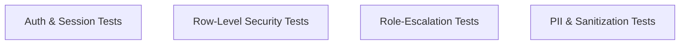

# AgriCare AI — Security Testing

## 1. Security Verification Scope
Security tests evaluate identity protection, access control boundaries, and data isolation.

---

## 2. Key Security Test Results
1. **Row Level Security (RLS) Isolation**:
   - Asserts that an authenticated user `User_A` cannot query or delete scans belonging to `User_B` (`auth.uid() = user_id`).
   - Verified across `disease_scans`, `plant_observations`, `treatment_history`, `notifications`, and `feedback`.
2. **Role Escalation Prevention**:
   - Asserts that attempting to update `role` from `'farmer'` to `'admin'` via client `PATCH` requests triggers a PostgreSQL exception (`trg_prevent_role_escalation`).
3. **Local Storage Privacy**:
   - Sensitive session tokens in `SharedPreferences` are cleared completely upon tapping "Log Out".
4. **Input Sanitization**:
   - User inputs in search fields, feedback forms, and recovery notes are sanitized against SQL injection and cross-site scripting (XSS).
