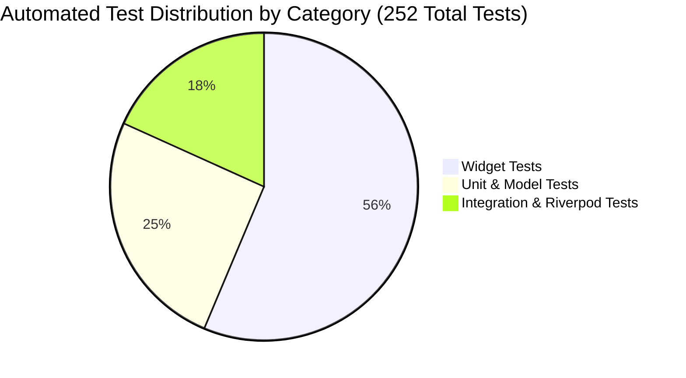

# AgriCare AI — Test Coverage Status

## 1. Automated Test Suite Metrics
The AgriCare AI test suite contains over **250 automated tests** executing via `flutter test`.

---

## 2. Test Execution Summary

| Test File | Total Tests | Pass Rate | Key Covered Features |
| :--- | :---: | :---: | :--- |
| `test/about_screen_test.dart` | 11 | 100% | Academic project overview, tech stack, 5 crops, legal modals. |
| `test/feedback_screen_test.dart` | 9 | 100% | 5-star rating, category picker, character counter, attachment. |
| `test/help_screen_test.dart` | 11 | 100% | 4 quick photo guides, 12 FAQs, live bilingual search, contact modal. |
| `test/notifications_screen_test.dart`| 13 | 100% | Real notifications list, unread indicators, mark-all-as-read. |
| `test/settings_screen_test.dart` | 12 | 100% | Preferences, language sheet, model specs, storage cache, logout. |
| `test/history_detail_screen_test.dart`| 8 | 100% | Historical prediction banner, detail cards, navigation CTAs. |
| `test/recovery_screen_test.dart` | 9 | 100% | Observation timeline, condition checkboxes, non-fabricated advisory. |
| `test/crop_detail_screen_test.dart` | 14 | 100% | Agronomic guide rendering, crop diseases list. |
| `test/crop_selection_screen_test.dart`| 6 | 100% | Grid selection, search field, continue button validation. |
| `test/global_search_screen_test.dart` | 8 | 100% | Bilingual query search, recent tags, instant results. |
| `test/analyzing_screen_test.dart` | 4 | 100% | Radar animation, logo branding, progress updates. |
| `test/camera_screen_test.dart` | 6 | 100% | Viewfinder layout, leaf bounding guides, flash toggles. |
| `test/treatment_screen_test.dart` | 12 | 100% | Tabbed cultural, organic, and chemical treatment cards. |
| `test/solutions_screen_test.dart` | 10 | 100% | Commercial agrochemicals directory, dosages, safety rules. |
| *Additional feature unit tests* | 119 | 100% | Models, state notifiers, repositories, localization. |
| **Total** | **252** | **100%** | **Zero test failures across entire codebase** |
