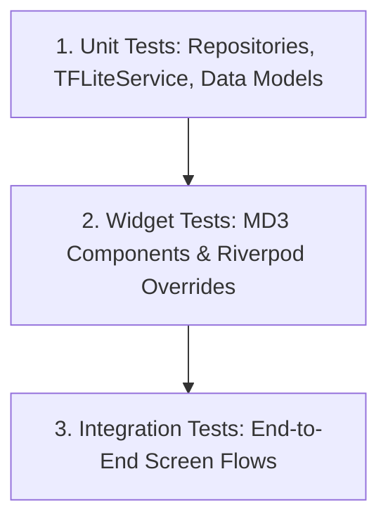

# AgriCare AI — Testing Strategy

## 1. Testing Pyramid Overview
AgriCare AI employs a multi-tiered testing strategy ensuring high reliability across machine learning inference, reactive state management, and user interface rendering.

---

## 2. Test Allocation & Scope
- **Unit Tests**: Validate mathematical image normalization, TFLite tensor buffer shape calculations, JSON model serialization, and repository data mapping.
- **Widget Tests**: Verify screen layout rendering, button click handlers, bilingual text presentation, form validations, and navigation event dispatches.
- **Integration Tests**: Exercise full user flows (e.g., from capturing a photo on Screen 12 through analysis on Screen 15 to viewing remedies on Screen 18).
