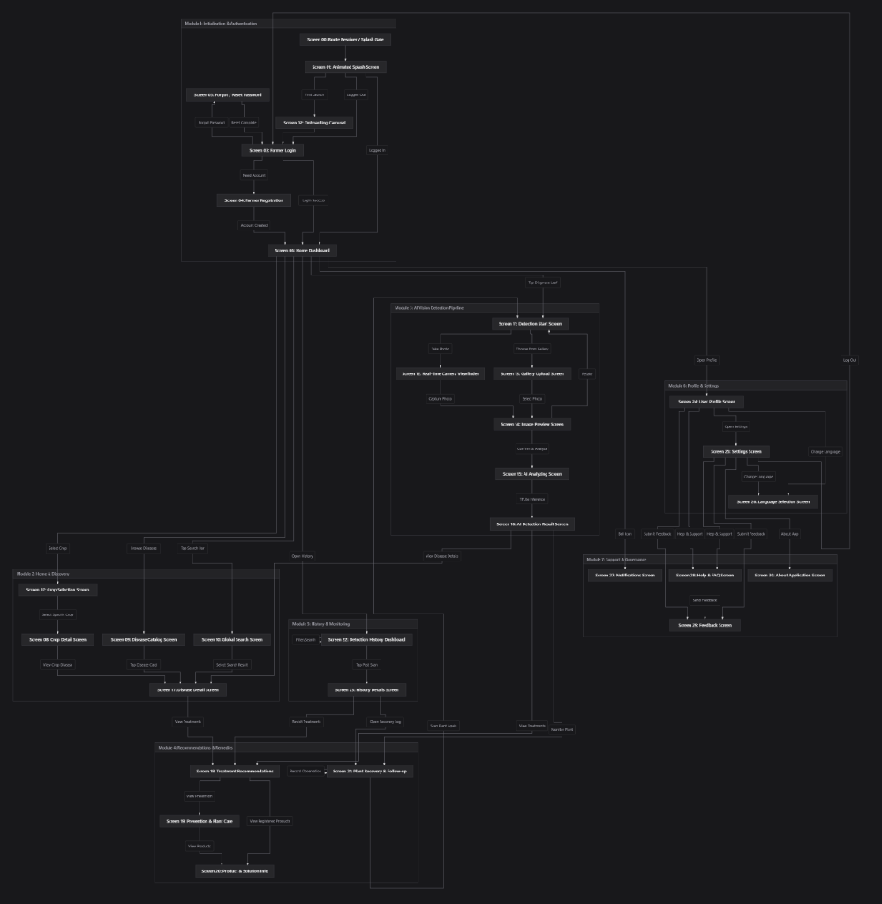

# AgriCare AI (LeafAgro) — Documentation Index

Welcome to the comprehensive technical, architectural, AI model, API, database, and user documentation for **AgriCare AI (LeafAgro)**.

Developed as an academic final-year capstone project in the **Department of Computer Science & Engineering, Faculty of Engineering & Technology**, AgriCare AI is an edge-first, offline-capable plant disease detection and agricultural advisory mobile application tailored for Bangladeshi farmers.

---

## Documentation Structure

```text
documentation/
├── 01_Project_Overview/           # Project overview, scope, objectives, requirements
│   ├── project_overview.md
│   ├── project_objectives.md
│   ├── project_scope.md
│   ├── features_and_requirements.md
│   └── technology_stack.md
├── 02_System_Architecture/        # Clean architecture, layers, components, ADRs
│   ├── system_architecture.md
│   ├── application_architecture.md
│   ├── backend_architecture.md
│   ├── frontend_architecture.md
│   ├── component_diagram.md
│   ├── deployment_architecture.md
│   └── architecture_decisions.md
├── 03_AI_Model/                   # MobileNetV2 architecture, inference, training, 19 classes
│   ├── ai_model_overview.md
│   ├── model_architecture.md
│   ├── model_training_and_dataset.md
│   ├── model_evaluation.md
│   ├── model_inference_pipeline.md
│   ├── image_preprocessing.md
│   ├── supported_crops_and_diseases.md
│   ├── confidence_and_prediction.md
│   └── model_limitations.md
├── 04_API_Documentation/          # Supabase REST and Auth endpoints
│   ├── api_overview.md
│   ├── authentication_api.md
│   ├── user_profile_api.md
│   ├── disease_detection_api.md
│   ├── crop_api.md
│   ├── history_api.md
│   ├── notification_api.md
│   ├── feedback_api.md
│   ├── storage_api.md
│   └── error_handling.md
├── 05_Database/                   # PostgreSQL schema, ERD, tables, RLS, migrations
│   ├── database_overview.md
│   ├── database_schema.md
│   ├── entity_relationship_diagram.md
│   ├── tables_and_columns.md
│   ├── relationships_and_constraints.md
│   ├── indexes_and_triggers.md
│   ├── row_level_security.md
│   ├── storage_buckets.md
│   └── database_migrations.md
├── 06_User_Flow/                  # Master application flow (00-30), module diagrams
│   ├── user_flow_overview.md
│   ├── complete_application_user_flow.md
│   ├── authentication_flow.md
│   ├── plant_detection_flow.md
│   ├── history_and_recovery_flow.md
│   ├── profile_and_settings_flow.md
│   ├── notification_flow.md
│   └── feedback_and_support_flow.md
├── 07_UI_UX_Documentation/        # Screen inventory (00-30), design system, localization
│   ├── screen_inventory.md
│   ├── navigation_structure.md
│   ├── design_system.md
│   ├── localization.md
│   └── screen_specifications.md
├── 08_User_Manual/                # Farmer user guide, photo taking, treatments, FAQ
│   ├── user_manual.md
│   ├── getting_started.md
│   ├── account_registration_and_login.md
│   ├── plant_disease_detection_guide.md
│   ├── taking_good_leaf_photos.md
│   ├── understanding_detection_results.md
│   ├── treatment_and_prevention_guide.md
│   ├── detection_history_guide.md
│   ├── profile_and_settings_guide.md
│   ├── language_selection_guide.md
│   ├── help_and_feedback_guide.md
│   └── troubleshooting.md
├── 09_Development_Guide/          # Setup, structure, dependencies, build, testing
│   ├── development_setup.md
│   ├── project_structure.md
│   ├── dependency_management.md
│   ├── environment_configuration.md
│   ├── supabase_setup.md
│   ├── build_and_run.md
│   ├── testing_guide.md
│   └── contribution_guidelines.md
├── 10_Testing/                    # Testing strategy, unit, widget, security, coverage
│   ├── testing_strategy.md
│   ├── unit_testing.md
│   ├── widget_testing.md
│   ├── integration_testing.md
│   ├── ai_model_testing.md
│   ├── security_testing.md
│   └── test_coverage_status.md
├── 11_Project_Reference/          # Glossary, future roadmap, references, metadata
│   ├── glossary.md
│   ├── limitations_and_future_work.md
│   ├── references_and_resources.md
│   └── project_metadata.md
├── CHANGELOG.md                   # Chronological project update history
└── DOCUMENTATION_STATUS.md        # Complete audit and verification sign-off
```

---

## Master Application Flowchart (Screens 00 to 30)



*The complete user flow diagram covers all 31 operational screens across 7 core functional modules from initialization to post-recovery follow-ups and support.*

---

## Key Highlights
- **100% Verified Ground Truth**: Zero fabricated metrics or unsupported academic affiliations.
- **Complete Screen Coverage**: Documents all 31 screens from Screen 00 (Splash Resolver) through Screen 30 (About Application).
- **Offline ML Pipeline**: Fully documents on-device MobileNetV2 $224 \times 224$ TensorFlow Lite inference.
- **Enterprise Relational Backend**: Full documentation of Supabase PostgreSQL schema, Row Level Security, indexes, triggers, and migrations 001–006.
- **250+ Passing Tests**: 100% test pass rate across the comprehensive automated test suite.

