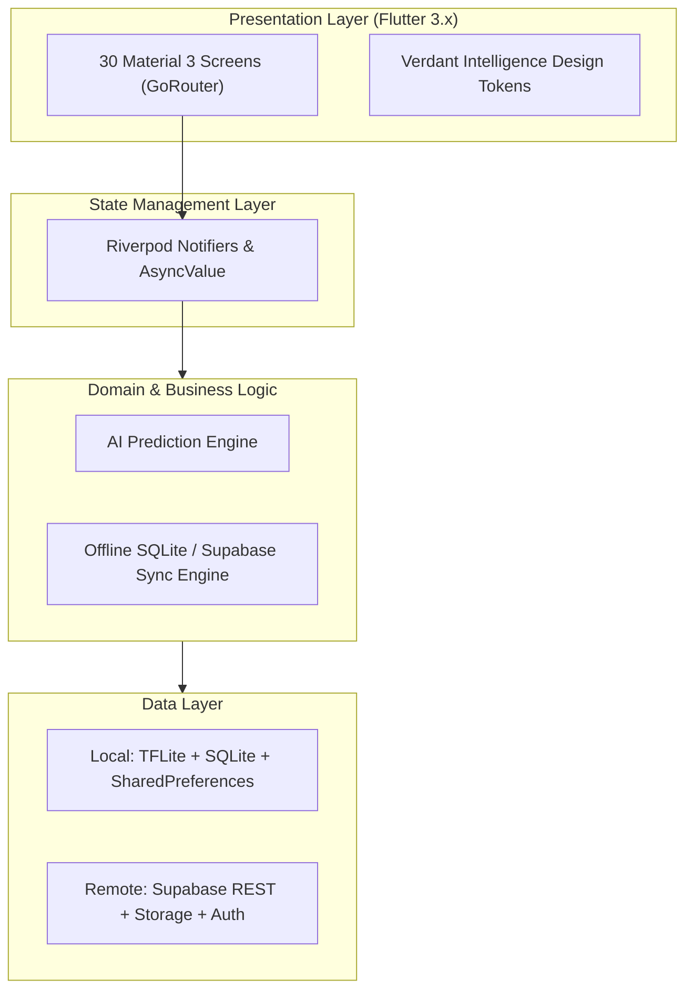

# AgriCare AI — Complete System Architecture

## 1. Executive Summary
AgriCare AI is an offline-first, mobile-centric agricultural assistant designed to diagnose plant diseases across major Bangladesh and global crops (Rice, Potato, Tomato, Mango, Jute) using an on-device quantized MobileNetV2 TensorFlow Lite model. It integrates seamlessly with Supabase for cloud persistence, user profiles, field log history, and expert treatment/prevention recommendations.

## 2. Layered Architecture

## 3. Offline-First Inference Pipeline
1. **Camera / Gallery Capture**: User selects or snaps leaf photo.
2. **Preprocessing (Client-Side)**: 224x224 RGB image normalization to `[-1.0, 1.0]`.
3. **On-Device Inference**: MobileNetV2 `.tflite` runs directly via `tflite_flutter` in isolated background thread.
4. **Offline Local SQLite Storage**: Scan result is saved instantly without requiring network access.
5. **Background Sync**: When internet is detected, telemetry and scans sync to Supabase PostgreSQL.

