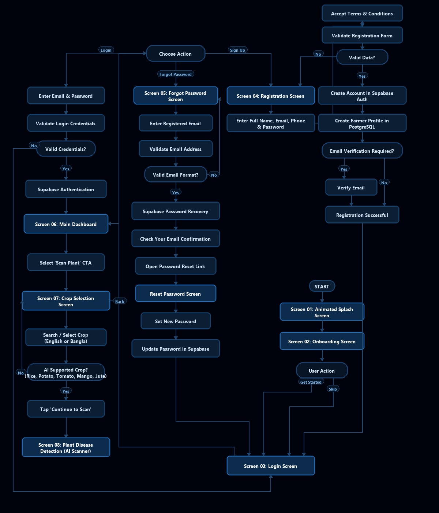
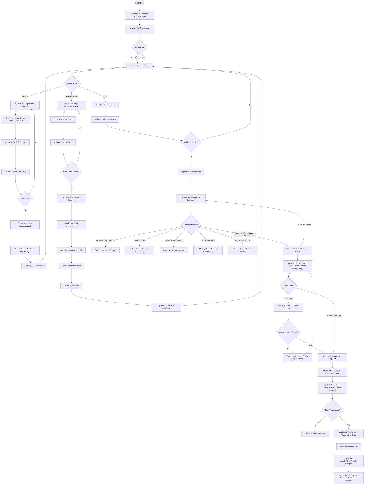
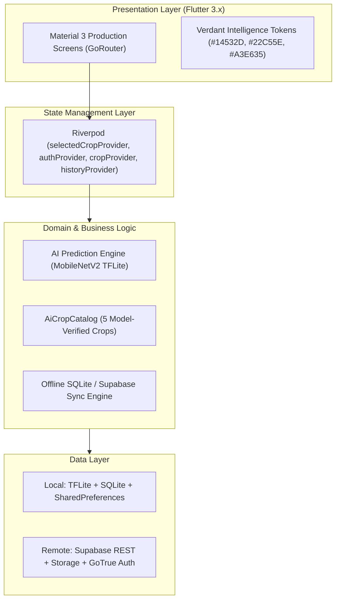

# AgriCare AI — Complete System Architecture
*Comprehensive Flow, On-Device Neural Vision, and Cloud Persistence for Screens 01–07*

## 1. Executive Summary
AgriCare AI is an offline-first, mobile-centric agricultural assistant designed to diagnose plant diseases across major Bangladeshi and global crops (**Rice**, **Potato**, **Tomato**, **Mango**, **Jute**) using an on-device quantized MobileNetV2 TensorFlow Lite model. It integrates seamlessly with Supabase for cloud persistence, user profiles, field log history, and expert treatment/prevention recommendations.

---

## 2. Complete Application Flow & Architecture (Screens 01–07)

### Complete Flowchart (Mermaid)

---

## 3. Implemented Production Screens (Screens 01–07)

### Screen 01: Animated Splash Screen
- **Centerpiece:** Vector leaf silhouette, circuit nodes, HUD ring, and animated AI laser sweep.
- **Route:** `/splash`

### Screen 02: Onboarding Screen
- **Components:** 3 curated farmer cards (Smart Disease Detection, Offline Diagnosis, Maximum Yield), interactive `EN` \| `বাংলা` language toggle, and smooth PageView.
- **Route:** `/onboarding`

### Screen 03: Login Screen
- **Components:** `AuthLogoBadge`, bilingual form with email regex validation, password visibility toggle, "Remember me", guest offline bypass, and Google OAuth button.
- **Route:** `/login`

### Screen 04: Registration Screen
- **Components:** 5 core form fields, Bangladesh `+880` mobile standardizer, real-time password checklist, interactive Terms & Privacy dialogs, and Supabase Auth creation.
- **Route:** `/register`

### Screen 05: Forgot Password & Password Recovery
- **Components:** `RecoveryHeroIllustration`, 3-phase animated recovery (Input → Progress → Check Email), spam folder advisory, 30s resend cooldown timer, and deep link `/reset-password`.
- **Route:** `/forgot-password` & `/reset-password`

### Screen 06: Main Home Dashboard
- **Components:**
  - `DashboardHeader`: Dynamic morning/afternoon/evening greeting, authenticated farmer name, avatar with initials/photo, unread notification counter, and language toggle.
  - `DashboardHeroCard`: Deep Forest Green to Fresh Green gradient, animated continuous laser scanning effect, and high-contrast `ScanPlantButton`.
  - `DashboardStatistics`: Real-time computed stats from actual scan logs (**Total Scans**, **Healthy Detections**, **Disease Detections**).
  - `ExploreCropsSection`: Horizontal carousel with 5 supported crops and "View All" encyclopedia link.
  - `RecentDetectionsSection`: Authenticated user's recent scans sorted newest first, status pills, confidence badges, and friendly empty state.
  - `DashboardBottomNavigation`: Fixed 4-tab bar (**Home**, **Detect**, **History**, **Profile**).
- **Route:** `/home`

### Screen 07: Crop Selection Screen
- **Components:**
  - `CropSelectionHeader`: Back button returning to dashboard, Step 01 badge, heading *"Select Your Crop"*, and bilingual subtitle.
  - `CropSearchField`: High-contrast search input filtering crop names in English and Bengali with instant clear-search action.
  - `CropSelectionGrid`: Responsive 2-column grid (`crossAxisCount: 2`) strictly displaying the 5 AI-supported crops (Rice, Potato, Tomato, Mango, Jute).
  - `CropSelectionCard`: Realistic agricultural imagery, "AI Ready" tag, detectable disease count, and tactile press animation.
  - `CropSelectionIndicator`: Fresh Green check-circle icon on selected card.
  - `EmptyCropSearchState`: Informative empty query prompt with supported crop advisory and reset button.
  - `ContinueButton`: Fixed bottom action button enabled only upon single-crop selection, writing to `selectedCropProvider` and navigating to Screen 08 (`/detect`).
- **Route:** `/crop-select`

---

## 4. Layered System Architecture

---

## 5. Offline-First AI Inference Pipeline
1. **Crop Selection (Screen 07)**: Farmer selects plant species (Rice, Potato, Tomato, Mango, or Jute), setting active context.
2. **Camera / Gallery Capture (Screen 08)**: User snaps leaf photo under natural daylight.
3. **Preprocessing (Client-Side)**: 224x224 RGB image normalized to `[-1.0, 1.0]`.
4. **On-Device Inference**: MobileNetV2 quantized `.tflite` model evaluates tensor data locally via `tflite_flutter` in under 300ms without requiring internet.
5. **Local SQLite Persistence**: Prediction record and confidence score are saved immediately.
6. **Cloud Synchronization**: When cellular or Wi-Fi connectivity is established, scans and images sync to Supabase PostgreSQL and private storage buckets.
