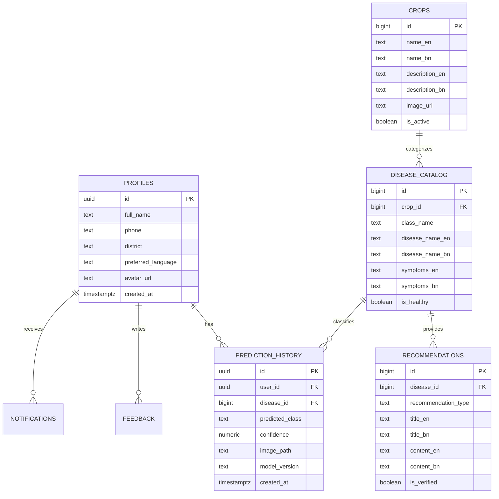

# AgriCare AI — Database Design (PostgreSQL & SQLite)

## 1. Cloud Database Schema (Supabase PostgreSQL)

## 2. Local Database Schema (SQLite / Drift)
The local SQLite database mirrors `prediction_history` with an added `sync_status` (`pending`, `synced`, `failed`) column to ensure seamless offline resilience and zero data loss in rural agricultural environments.

