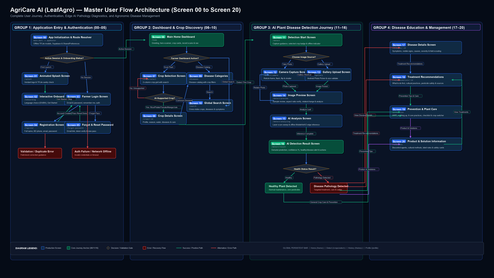
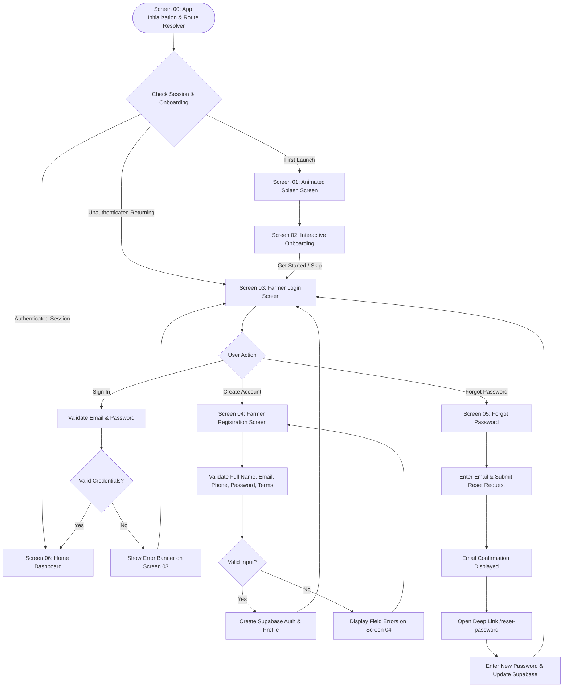
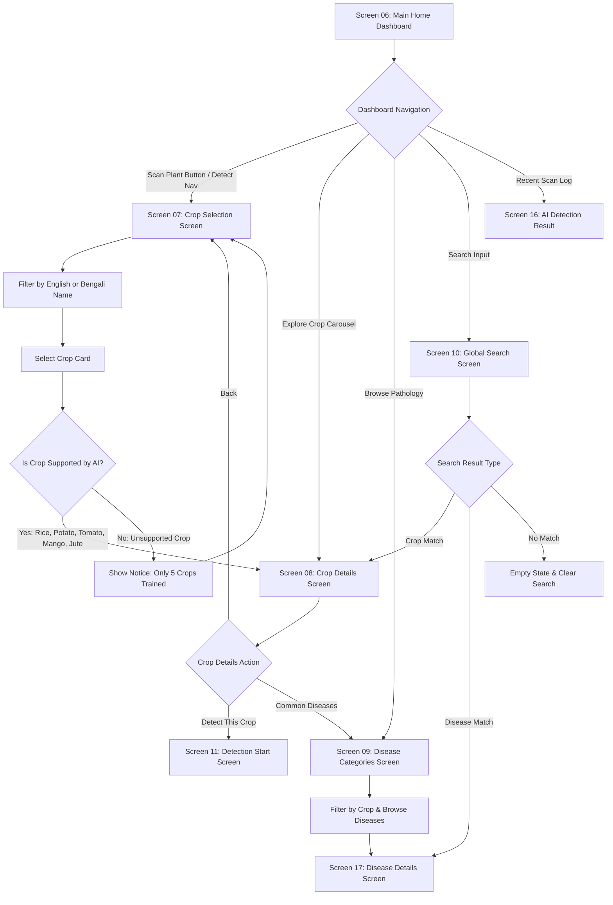
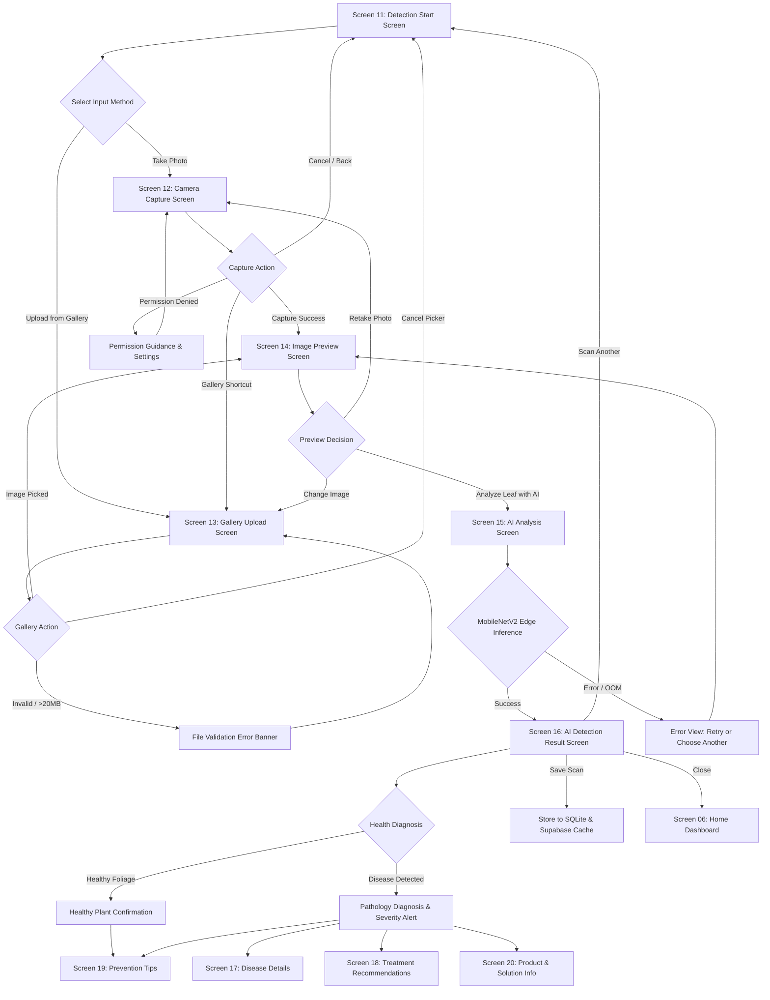
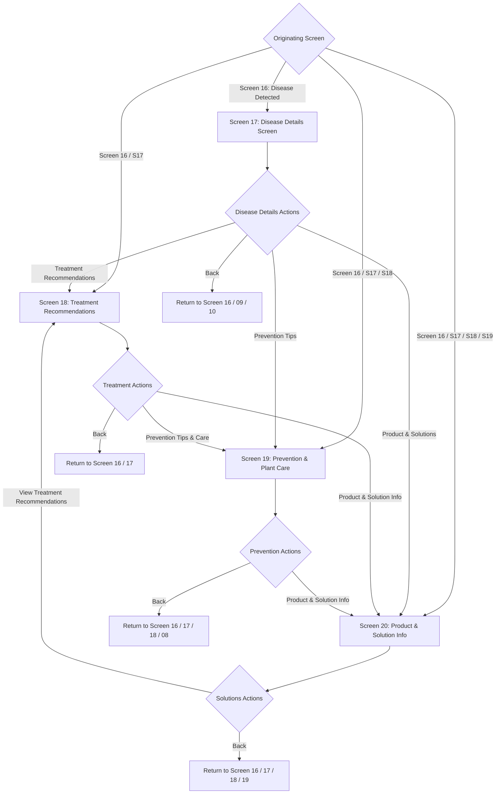

# AgriCare AI (LeafAgro) — User Flow Architecture & Navigation Reference
*Complete Technical User Journey from Screen 00 to Screen 20 for Developers and UI/UX Architects*

---

## 1. Master Application Flowchart (Screen 00 to Screen 20)

```mermaid
flowchart TB
    classDef startEnd fill:#0F172A,stroke:#38BDF8,stroke-width:2px,color:#F8FAFC;
    classDef screenNode fill:#102A43,stroke:#2563EB,stroke-width:2px,color:#F8FAFC;
    classDef highlightScreen fill:#064E3B,stroke:#10B981,stroke-width:2.5px,color:#ECFDF5;
    classDef decisionNode fill:#1E293B,stroke:#F59E0B,stroke-width:2px,color:#FEF3C7;
    classDef errorNode fill:#450A0A,stroke:#EF4444,stroke-width:1.5px,color:#FEE2E2;
    classDef noteNode fill:#1E293B,stroke:#64748B,stroke-width:1.5px,color:#CBD5E1;
    classDef successNode fill:#064E3B,stroke:#10B981,stroke-width:1.5px,color:#D1FAE5;

    subgraph G1 ["GROUP 1: Application Entry & Authentication (Screens 00–05)"]
        S00["<b>Screen 00</b><br/>App Initialization & Route Resolver<br/><i>(TFLite & Supabase Init)</i>"]:::startEnd
        D_Session{"Active Session &<br/>Onboarding Status?"}:::decisionNode
        S01["<b>Screen 01</b><br/>Animated Splash Screen<br/><code>/splash</code>"]:::screenNode
        S02["<b>Screen 02</b><br/>Interactive Onboarding<br/><code>/onboarding</code>"]:::screenNode
        S03["<b>Screen 03</b><br/>Farmer Login Screen<br/><code>/login</code>"]:::screenNode
        S04["<b>Screen 04</b><br/>Farmer Registration<br/><code>/register</code>"]:::screenNode
        S05["<b>Screen 05</b><br/>Forgot & Reset Password<br/><code>/forgot-password & /reset-password</code>"]:::screenNode
        Err_Auth["Invalid Credentials /<br/>Network Timeout Error"]:::errorNode
        Err_Reg["Validation Failure /<br/>Duplicate Account Error"]:::errorNode
        Err_Reset["Expired Token /<br/>Invalid Email Error"]:::errorNode

        S00 --> D_Session
        D_Session -->|First Time Launch| S01
        D_Session -->|Existing Session Active| S06_Anchor["<b>Screen 06: Home Dashboard</b>"]:::highlightScreen
        D_Session -->|Unauthenticated User| S03
        S01 --> S02
        S02 -->|Get Started / Skip| S03
        S03 -->|Tap Create Account| S04
        S03 -->|Tap Forgot Password| S05
        S03 -->|Submit Valid Credentials| S06_Anchor
        S03 -.->|Invalid Input / Offline| Err_Auth
        Err_Auth -.->|Retry| S03
        S04 -->|Submit Valid Profile| S03
        S04 -.->|Validation / Duplicate Error| Err_Reg
        Err_Reg -.->|Correct Errors| S04
        S04 -->|Already have account| S03
        S05 -->|Submit Email & Deep Link Reset| S03
        S05 -.->|Invalid Link / Timeout| Err_Reset
        Err_Reset -.->|Retry| S05
    end

    subgraph G2 ["GROUP 2: Dashboard & Crop Discovery (Screens 06–10)"]
        S06["<b>Screen 06</b><br/>Home Dashboard<br/><code>/home</code>"]:::highlightScreen
        D_Nav{"Farmer Dashboard Action"}:::decisionNode
        S07["<b>Screen 07</b><br/>Crop Selection Screen<br/><code>/crops/select</code>"]:::screenNode
        S08["<b>Screen 08</b><br/>Crop Details Screen<br/><code>/crops/:id</code>"]:::screenNode
        S09["<b>Screen 09</b><br/>Disease Categories Screen<br/><code>/diseases</code>"]:::screenNode
        S10["<b>Screen 10</b><br/>Global Search Screen<br/><code>/search</code>"]:::screenNode
        D_CropSupport{"Selected Crop<br/>Supported by AI?"}:::decisionNode
        Warn_Crop["Informational Banner:<br/>Only Rice, Potato, Tomato, Mango,<br/>Jute supported by AI model"]:::noteNode

        S06_Anchor --> S06
        S06 --> D_Nav
        D_Nav -->|Scan Plant / Detect Nav| S07
        D_Nav -->|Explore Crop Card| S08
        D_Nav -->|Disease Categories| S09
        D_Nav -->|Global Search Bar| S10
        S07 --> D_CropSupport
        D_CropSupport -->|Yes: Rice, Potato, Tomato, Mango, Jute| S08
        D_CropSupport -->|No: Unsupported Crop| Warn_Crop
        Warn_Crop -.->|Reselect Crop| S07
        S08 -->|Detect This Crop| S11_Anchor["<b>Screen 11: Detection Start</b>"]:::highlightScreen
        S08 -->|Common Diseases| S09
        S08 -->|Back| S07
        S07 -->|Back| S06
        S09 -->|Select Disease Card| S17_Anchor["<b>Screen 17: Disease Details</b>"]:::screenNode
        S09 -->|Search Diseases| S10
        S09 -->|Back| S06
        S10 -->|Select Crop Result| S08
        S10 -->|Select Disease Result| S17_Anchor
        S10 -->|Back| S06
    end

    subgraph G3 ["GROUP 3: AI Plant Disease Detection Journey (Screens 11–16)"]
        S11["<b>Screen 11</b><br/>Detection Start Screen<br/><code>/detect</code>"]:::highlightScreen
        D_InputSource{"Choose Image Source"}:::decisionNode
        S12["<b>Screen 12</b><br/>Camera Capture Screen<br/><code>/detect/camera</code>"]:::screenNode
        S13["<b>Screen 13</b><br/>Gallery Upload Screen<br/><code>/detect/gallery</code>"]:::screenNode
        S14["<b>Screen 14</b><br/>Image Preview Screen<br/><code>/detect/preview</code>"]:::screenNode
        S15["<b>Screen 15</b><br/>AI Analysis Screen<br/><code>/detect/analyzing</code>"]:::screenNode
        S16["<b>Screen 16</b><br/>AI Detection Result Screen<br/><code>/detect/result</code>"]:::highlightScreen
        Err_Cam["Camera Permission Denied /<br/>Sensor Unavailable"]:::errorNode
        Err_File["Unsupported Format /<br/>Corrupt Image (>20MB)"]:::errorNode
        Err_Infer["TFLite Model Error /<br/>Analysis Failure"]:::errorNode
        D_DiagResult{"Diagnosis Result State"}:::decisionNode
        State_Healthy["Healthy Plant Detected<br/><i>(Standard Maintenance & Prevention)</i>"]:::successNode
        State_Diseased["Pathology Detected<br/><i>(Severity, Confidence & Advisory)</i>"]:::decisionNode

        S11_Anchor --> S11
        S11 --> D_InputSource
        D_InputSource -->|Take Photo| S12
        D_InputSource -->|Upload from Gallery| S13
        S12 -->|Capture Success| S14
        S12 -.->|Permission Denied / Sensor Error| Err_Cam
        Err_Cam -.->|Go to Settings / Retry| S12
        S12 -->|Switch to Gallery| S13
        S12 -->|Cancel| S11
        S13 -->|Select Valid Image| S14
        S13 -.->|Invalid Image File| Err_File
        Err_File -.->|Reselect| S13
        S13 -->|Cancel Picker| S11
        S14 -->|Analyze Leaf with AI| S15
        S14 -->|Retake Photo| S12
        S14 -->|Change Image| S13
        S15 -->|TFLite Edge Inference Success| S16
        S15 -.->|Inference Failure| Err_Infer
        Err_Infer -.->|Retry Analysis| S15
        Err_Infer -.->|Choose Another Image| S14
        S16 --> D_DiagResult
        D_DiagResult -->|Healthy State| State_Healthy
        D_DiagResult -->|Disease Detected| State_Diseased
        S16 -->|Scan Another Plant| S11
        S16 -->|Save Scan to SQLite & Cloud| S16
        S16 -->|Close Button| S06
    end

    subgraph G4 ["GROUP 4: Disease Education & Management Journey (Screens 17–20)"]
        S17["<b>Screen 17</b><br/>Disease Details Screen<br/><code>/diseases/:id</code>"]:::screenNode
        S18["<b>Screen 18</b><br/>Treatment Recommendations<br/><code>/recommendations/:id</code>"]:::screenNode
        S19["<b>Screen 19</b><br/>Prevention & Plant Care<br/><code>/prevention & /prevention/:id</code>"]:::screenNode
        S20["<b>Screen 20</b><br/>Product & Solution Info<br/><code>/solutions & /solutions/:id</code>"]:::screenNode

        State_Diseased -->|View Disease Details| S17
        State_Diseased -->|Treatment Recommendations| S18
        State_Diseased -->|Prevention Tips| S19
        State_Diseased -->|Product & Solutions| S20
        State_Healthy -->|General Crop Care| S19
        S17_Anchor --> S17

        S17 -->|View Treatment Options| S18
        S17 -->|View Prevention Guide| S19
        S17 -->|View Solutions & Safety| S20
        S17 -->|Back| Prev_Context_17["Return to Source Context<br/>(Screen 16 / 09 / 10)"]:::noteNode

        S18 -->|View Prevention Tips| S19
        S18 -->|Product & Solution Info| S20
        S18 -->|Back| Prev_Context_18["Return to Source Context<br/>(Screen 16 / 17)"]:::noteNode

        S19 -->|Product & Solution Info| S20
        S19 -->|Back| Prev_Context_19["Return to Source Context<br/>(Screen 16 / 17 / 18 / 08)"]:::noteNode

        S20 -->|View Treatment Recommendations| S18
        S20 -->|Back| Prev_Context_20["Return to Source Context<br/>(Screen 16 / 17 / 18 / 19)"]:::noteNode
    end
```

---

## 2. Modular Journey Sub-Flowcharts

### A. Authentication Flow Diagram (Screens 00–05)

---

### B. Dashboard & Crop Discovery Flow Diagram (Screens 06–10)

---

### C. AI Detection Workflow Flow Diagram (Screens 11–16)

---

### D. Disease Management & Agronomic Guidance Flow Diagram (Screens 17–20)

---

## 3. Screen Navigation Mapping Reference Table

| Screen # | Screen Title | Route Path | Core Purpose | Incoming Routes | Outgoing Routes | Key Decision Points / Fallbacks |
| :--- | :--- | :--- | :--- | :--- | :--- | :--- |
| **00** | **App Initialization & Route Resolver** | `main.dart` entry | System startup, TFLite engine check, Supabase auth check, onboarding status resolver | Cold start / App launch | `01`, `03`, `06` | First launch → `01`; Unauthenticated → `03`; Authenticated session → `06` |
| **01** | **Animated Splash Screen** | `/splash` | Brand introduction, visual scanning HUD, background initialization | `00` | `02`, `03`, `06` | Directs to `02` (Onboarding) or bypasses if already completed |
| **02** | **Interactive Onboarding** | `/onboarding` | Agricultural AI education, value proposition, bilingual toggle (EN/BN) | `01` | `03` | User taps **Get Started** or **Skip** → marks completed in `SharedPreferences` |
| **03** | **Farmer Login Screen** | `/login` | Farmer authentication via email/password, session storage, OAuth | `00`, `02`, `04`, `05` | `04`, `05`, `06` | Valid credentials → `06`; Invalid → Error banner on `03`; Forgot pass → `05` |
| **04** | **Farmer Registration Screen** | `/register` | Account creation, BD mobile validation (+880), terms agreement | `03` | `03` | Valid input → creates Supabase Auth record & profile → returns to `03` |
| **05** | **Forgot Password & Recovery** | `/forgot-password`, `/reset-password` | Self-service password recovery, email reset link, password update | `03` | `03` | Valid email dispatches recovery email; deep link navigates to `/reset-password` |
| **06** | **Main Home Dashboard** | `/home` | Central hub, dynamic greeting, scan CTA, explore crops, recent detections, global nav | `00`, `03`, `16` (Close) | `07`, `08`, `09`, `10`, `16` | Persistent Bottom Bar (`Home`, `Detect`, `History`, `Profile`); Scan CTA → `07` |
| **07** | **Crop Selection Screen** | `/crops/select` | Crop discovery grid, search filtering across verified AI-supported crops | `06`, `08` (Back) | `06`, `08` | Is crop AI-supported? (Rice, Potato, Tomato, Mango, Jute) → Yes: Enable Continue |
| **08** | **Crop Details Screen** | `/crops/:id` | Agronomic profile, growing season, water/soil needs, common diseases, care tips | `06`, `07`, `10` | `07`, `09`, `11` | Primary action: **"Detect [Crop] Disease"** → sets crop context and routes to `11` |
| **09** | **Disease Categories Screen** | `/diseases` | Pathology encyclopedia, crop filter chips, disease search | `06`, `08` | `06`, `10`, `17` | Selecting disease card routes to botanical profile (`17`) |
| **10** | **Global Search Screen** | `/search` | Cross-indexed instant search across all crops, diseases, and symptoms | `06`, `08`, `09` | `06`, `08`, `17` | Selecting crop result → `08`; Selecting disease result → `17`; No match → Empty State |
| **11** | **Detection Start Screen** | `/detect` | Diagnosis staging, leaf photography rules, active crop tag, camera/gallery entry | `06`, `08`, `12` (Cancel), `13` (Cancel), `16` (Rescan) | `08`, `12`, `13` | Farmer selects **"Take Photo"** (`12`) or **"Upload from Gallery"** (`13`) |
| **12** | **Camera Capture Screen** | `/detect/camera` | Full-screen live viewfinder, leaf positioning reticle, flash toggle, shutter capture | `11`, `14` (Retake) | `11`, `13`, `14` | Capture photo → `14`; Permission error → Settings advisory; Gallery shortcut → `13` |
| **13** | **Gallery Upload Screen** | `/detect/gallery` | Native Android Photo Picker, image validation (format, file size < 20MB) | `11`, `12`, `14` (Change) | `11`, `14` | Valid image → `14`; Dismiss picker → `11`; Corrupted/oversized image → Error banner |
| **14** | **Image Preview Screen** | `/detect/preview` | Leaf specimen confirmation, aspect-ratio review, image quality status | `12`, `13`, `15` (Retry) | `12`, `13`, `15` | Tap **Analyze Leaf with AI** → `15`; Tap **Retake** → `12`; Tap **Change Image** → `13` |
| **15** | **AI Analysis Screen** | `/detect/analyzing` | Scanning visualization, on-device MobileNetV2 quantized TFLite inference | `14` | `14`, `16` | Inference complete → `16`; Inference error → Display error with retry / reselect |
| **16** | **AI Detection Result Screen** | `/detect/result` | Primary diagnosis, confidence %, healthy vs diseased alert, disclaimer, history save | `06`, `15` | `06`, `11`, `17`, `18`, `19`, `20` | Disease detected → routes to `17`, `18`, `19`, `20`; Healthy plant → routes to `19` |
| **17** | **Disease Details Screen** | `/diseases/:id` | Botanical overview, visible leaf markers, causes, pathogens, literary severity | `09`, `10`, `16` | `16`, `18`, `19`, `20` | Directly routes to Treatments (`18`), Prevention (`19`), or Solutions (`20`) |
| **18** | **Treatment Recommendations** | `/recommendations/:id` | Immediate actions, cultural sanitation, verified BRRI/BARI treatments, chemical safety | `16`, `17`, `20` | `16`, `17`, `19`, `20` | Directly routes to Prevention (`19`) or Product & Solution Info (`20`) |
| **19** | **Prevention & Plant Care** | `/prevention`, `/prevention/:id` | 6 core prevention pillars, AWD/irrigation, crop switcher, interactive persisted checklist | `08`, `16`, `17`, `18` | `16`, `17`, `18`, `20` | Disease context present → disease protocols; Standalone → general crop care tips |
| **20** | **Product & Solution Information** | `/solutions`, `/solutions/:id` | Biocontrol agents, cultural methods, approved chemical rules, 6 safety cards, extension officer | `16`, `17`, `18`, `19` | `16`, `17`, `18`, `19` | Primary CTA: **"View Treatment Recommendations"** routes to `18`; strictly non-commercial |

---

## 4. UX Improvement Analysis & Design Rationale

### Comparison: Original Flowchart vs. Redesigned User Flow

| Area | Original Diagram Flaws | Redesigned User Flow Architecture |
| :--- | :--- | :--- |
| **1. Screen Numbering Consistency** | Truncated at Screen 07; Screen 08 was mistakenly labeled as generic "Plant Image Capture" before features were built. | Establishes a complete, uniform **Screen 00 through Screen 20** taxonomy matching the exact Flutter router table (`app_router.dart`). |
| **2. Application Entry & Session Resolution** | Began directly at Screen 01 without explaining how returning or authenticated users bypass onboarding and login. | Introduces **Screen 00 (App Initialization / Route Resolver)** with a tri-state session gateway (First Launch → Splash/Onboarding; Returning Unauthenticated → Login; Authenticated Session → Dashboard). |
| **3. Registration & Password Recovery** | Simple one-way arrows with no validation feedback, duplicate account handling, or password reset deep-linking. | Explicitly models form validation, duplicate email detection, email dispatch confirmation, and `/reset-password` deep-link returns. |
| **4. Crop Discovery vs. AI Diagnosis** | Confusing transition between browsing crops and launching detection, assuming detection happens immediately on crop select. | Cleanly decouples **Crop Selection (07)** → **Crop Details (08)** → **Detection Start (11)**. Retains crop context across state without forcing immediate camera capture. |
| **5. Dual Input Modality (Camera vs. Gallery)** | Omitted camera permissions, flash toggles, reticle framing, Android 13+ Photo Picker privacy, and image validation. | Accurately models **Screen 12 (Camera Capture)** with live reticle, flash toggle, and direct gallery jump, alongside **Screen 13 (Gallery Upload)** with Android Photo Picker and size limits (< 20MB). |
| **6. Specimen Review & Scanning Feedback** | Jumped straight from image capture to results with no user review or quality feedback. | Integrates **Screen 14 (Image Preview)** for quality/clarity verification, followed by **Screen 15 (AI Analysis)** with honest indeterminate progress and edge TFLite error recovery. |
| **7. Healthy vs. Disease Detected Branching** | Assumed every scan outputs a disease requiring chemical treatment, violating agricultural safety. | **Screen 16** implements a strict binary branch: **Disease Detected** (shows severity, verified treatments, and safety rules) vs. **Healthy Plant** (strictly omits pesticide advice, suggesting standard cultural maintenance and prevention). |
| **8. Four-Pillar Disease Management (17–20)** | Disease details, treatment recommendations, prevention tips, and product solutions were completely missing. | Fully models the post-diagnosis educational quartet: **17 (Disease Details)**, **18 (Treatment Recommendations)**, **19 (Prevention & Care)**, and **20 (Product & Solution Information)** with bi-directional inter-screen links. |
| **9. Context-Aware Return Navigation** | Forced users backward along one rigid path, creating annoying navigation loops for farmers. | Incorporates **context-aware back navigation** (e.g., exiting Screen 18 safely returns to Screen 16 or Screen 17 depending on where the farmer originated). |
| **10. Persistent Global Navigation** | Represented bottom navigation as separate sequential screens, cluttering the diagram. | Models bottom navigation as a persistent structural overlay (`Home`, `Detect`, `History`, `Profile`) accessible globally across primary screens. |

---

## 5. Technical Architecture Summary for Developers

1. **Routing Scheme (`GoRouter`):**
   - Base paths: `/splash`, `/onboarding`, `/login`, `/register`, `/forgot-password`, `/reset-password`.
   - Core dashboard: `/home`, `/search`, `/profile`, `/history`.
   - Crop catalog: `/crops`, `/crops/:id`, `/crops/select`.
   - Disease catalog: `/diseases`, `/diseases/:id`.
   - Detection pipeline: `/detect`, `/detect/camera`, `/detect/gallery`, `/detect/preview`, `/detect/analyzing`, `/detect/result`.
   - Management: `/recommendations/:id`, `/prevention`, `/prevention/:id`, `/solutions`, `/solutions/:id`.
2. **State Management (`Riverpod`):**
   - `selectedCropProvider`: Stores active target crop (`CropModel`) selected by the farmer.
   - `detectionProvider`: Holds current `imagePath`, `PredictionModel`, and processing status.
   - `diseaseByIdProvider` / `cropByIdProvider`: Caches SQLite / Supabase entity data.
   - `recommendationsByDiseaseProvider`: Delivers verified BRRI/BARI treatment, care, and biological recommendations.
   - `settingsProvider`: Reactive language switching (`en` / `bn`).
3. **Offline Guarantee:**
   - On-device edge neural network: `MobileNetV2` quantized `.tflite` model (Rice, Potato, Tomato, Mango, Jute).
   - Local fallback catalog: `AiCropCatalog` provides full offline agronomic and pathology encyclopedia even without internet connectivity in rural fields.
