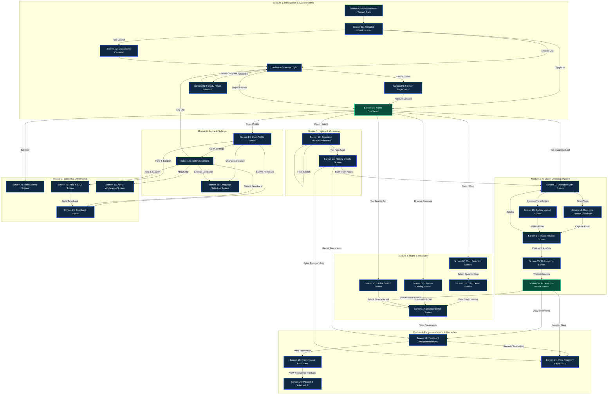

# AgriCare AI (LeafAgro) — Complete User Flow Architecture & Navigation Reference
*Full Technical User Journey from Screen 00 through Screen 30 Across All 7 Core Modules*

---

## 1. Master Application Flowchart (Screens 00 to 30)

The diagram below represents the complete end-to-end navigational architecture of AgriCare AI across all **31 implemented production screens** grouped into **7 functional modules**.

### Architectural Flow Graph (Mermaid)

---

## 2. Complete Screen Reference Table (Screens 00 to 30)

| Screen # | Screen Title | Route Path | Functional Module | Inbound Triggers | Outbound Targets | Primary Architectural Role |
| :---: | :--- | :--- | :--- | :--- | :--- | :--- |
| **00** | Route Resolver / Splash Gate | `/splash` (Gate) | M1: Init & Auth | Cold App Launch | `01` | Evaluates cached tokens, onboarding flag, network connectivity |
| **01** | Animated Splash Screen | `/splash` | M1: Init & Auth | `00` | `02`, `03`, `06` | Brand presentation, AI model loading, dynamic routing branch |
| **02** | Onboarding Carousel | `/onboarding` | M1: Init & Auth | `01` (First Launch) | `03` | 3-step agricultural AI introduction; skips to Login on finish |
| **03** | Farmer Login | `/login` | M1: Init & Auth | `01`, `02`, `05`, `25` | `04`, `05`, `06` | Supabase password authentication, guest offline mode bypass |
| **04** | Farmer Registration | `/register` | M1: Init & Auth | `03` | `06` | Account creation, 64-district selector, profile creation |
| **05** | Forgot / Reset Password | `/forgot-password` | M1: Init & Auth | `03` | `03` | Self-service password reset dispatch and deep-link handling |
| **06** | Home Dashboard | `/home` | M2: Discovery | `01`, `03`, `04` | `07`, `09`, `10`, `11`, `22`, `24`, `27` | Central hub, primary scan CTA, crop carousel, recent scan cards |
| **07** | Crop Selection Screen | `/crop-select` | M2: Discovery | `06` | `08` | 5-crop selector (Rice, Potato, Tomato, Mango, Jute) with search |
| **08** | Crop Detail Screen | `/crops/:id` | M2: Discovery | `07` | `17` | Botanical guide, growth cycle, linked diseases catalog |
| **09** | Disease Catalog Screen | `/diseases` | M2: Discovery | `06` | `17` | 19-class pathology encyclopedia with crop filtering chips |
| **10** | Global Search Screen | `/search` | M2: Discovery | `06` | `17` | Bilingual instant search across crops, diseases, and symptoms |
| **11** | Detection Start Screen | `/detect` | M3: AI Vision | `06`, `14`, `23` | `12`, `13` | Photography guide, active crop indicator, camera/gallery trigger |
| **12** | Real-time Camera Viewfinder | `/detect/camera` | M3: AI Vision | `11` | `14` | Camera preview, framing guide overlay, flash control, shutter |
| **13** | Gallery Upload Screen | `/detect/gallery` | M3: AI Vision | `11` | `14` | System image picker, resolution and file size preflight checks |
| **14** | Image Review Screen | `/detect/preview` | M3: AI Vision | `12`, `13` | `11`, `15` | Specimen quality check, blur alert, crop/rotate, confirmation |
| **15** | AI Analyzing Screen | `/detect/analyzing` | M3: AI Vision | `14` | `16` | Radar pulse animation, MobileNetV2 quantized edge inference |
| **16** | AI Detection Result Screen | `/detect/result` | M3: AI Vision | `15` | `17`, `18`, `21` | Diagnosis name, confidence gauge, severity status, action links |
| **17** | Disease Detail Screen | `/diseases/:id` | M2 / M3 Bridge | `08`, `09`, `10`, `16` | `18` | Symptoms, pathogens, biology, photo gallery, treatment CTA |
| **18** | Treatment Recommendations | `/recommendations/:id` | M4: Remedies | `16`, `17`, `23` | `19`, `21` | Tabbed cultural, organic, and chemical treatment protocols |
| **19** | Prevention & Plant Care | `/prevention` | M4: Remedies | `18` | `20` | Field sanitation, spacing, irrigation, and preventive practices |
| **20** | Product & Solution Info | `/solutions` | M4: Remedies | `19` | Context Back | Directory of approved agrochemicals, active ingredients, dosage |
| **21** | Plant Recovery & Follow-up | `/recovery` | M4: Remedies | `16`, `18`, `23` | Context Back | Longitudinal health tracker, observation notes, recovery timeline |
| **22** | Detection History Dashboard | `/history` | M5: History | `06` | `23` | Chronological list of scans, date filter, crop chips, sync status |
| **23** | History Details Screen | `/history/:id` | M5: History | `22` | `11`, `18`, `21` | Historical image review, diagnosis breakdown, re-scan trigger |
| **24** | User Profile Screen | `/profile` | M6: Profile | `06` | `25`, `26`, `28`, `29` | Farmer avatar, contact info, district, scan statistics, shortcuts |
| **25** | Settings Screen | `/settings` | M6: Profile | `24` | `03`, `26`, `28`, `29`, `30` | Cache management, offline model info, language, terms, logout |
| **26** | Language Selection Screen | `/settings/language` | M6: Profile | `24`, `25` | Context Back | Instant bilingual toggle (English / বাংলা) via Riverpod state |
| **27** | Notifications Screen | `/notifications` | M7: Governance | `06` | Context Back | Real system notifications, mark as read, disease outbreak alerts |
| **28** | Help & FAQ Screen | `/help` | M7: Governance | `24`, `25` | `29` | 4 photo guides, 12 searchable FAQs, direct contact modal |
| **29** | Feedback Screen | `/feedback` | M7: Governance | `24`, `25`, `28` | Context Back | 5-star rating, 5 feedback categories, 2,000-char feedback form |
| **30** | About Application Screen | `/about` | M7: Governance | `25` | Context Back | Academic capstone credits, tech stack, 5 verified crops, disclaimer |

---

## 3. Module Breakdown & Navigation Contracts

### Module 1: Initialization & Authentication (Screens 00–05)
- **Primary Goal:** Resolve the initial authentication state safely, introduce first-time farmers, handle credential verification, and route immediately to the dashboard for active sessions.
- **Routing Invariants:**
  - `Screen 00` (`Route Resolver`) inspects `authProvider` and local SharedPreferences.
  - If `isFirstLaunch == true` -> Routes to `Screen 01` -> `Screen 02` (`Onboarding`).
  - If authenticated session exists -> Directly enters `Screen 06` (`Home Dashboard`).
  - If unauthenticated -> Passes through `Screen 01` -> `Screen 03` (`Farmer Login`).
  - `Screen 04` (`Registration`) auto-logs in upon account creation and directly routes to `Screen 06`.
  - `Screen 05` (`Forgot Password`) sends a Supabase reset link and routes back to `Screen 03` on completion.

### Module 2: Home & Discovery (Screens 06–10, 17)
- **Primary Goal:** Act as the primary home base and reference library for crops and plant pathologies.
- **Routing Invariants:**
  - `Screen 06` acts as the primary hub connecting all other modules via the persistent bottom navigation bar and hero call-to-actions.
  - `Screen 07` (`Crop Selection`) allows choosing one of the 5 supported crops (Rice, Potato, Tomato, Mango, Jute) and transitions to `Screen 08` (`Crop Detail`).
  - `Screen 08`, `Screen 09` (`Disease Catalog`), and `Screen 10` (`Global Search`) all route into `Screen 17` (`Disease Detail Screen`) when a specific pathology is tapped.

### Module 3: AI Vision Detection Pipeline (Screens 11–16)
- **Primary Goal:** Guide the farmer through leaf image capture, preflight validation, neural network inference, and diagnostic presentation.
- **Routing Invariants:**
  - Triggered from `Screen 06` via the central "Diagnose Leaf" CTA.
  - `Screen 11` branches into `Screen 12` (Camera) or `Screen 13` (Gallery).
  - Both capture pathways converge into `Screen 14` (`Image Review Screen`) for quality verification.
  - `Screen 14` allows retaking (returns to `Screen 11`) or confirming (proceeds to `Screen 15`).
  - `Screen 15` runs offline MobileNetV2 TFLite inference and automatically transitions to `Screen 16` (`AI Detection Result`).
  - `Screen 16` links directly to `Screen 17` (`Disease Details`), `Screen 18` (`Treatments`), and `Screen 21` (`Recovery Follow-up`).

### Module 4: Recommendations & Remedies (Screens 18–21)
- **Primary Goal:** Deliver actionable, verified agronomic treatments, preventative measures, approved chemical solutions, and longitudinal recovery tracking.
- **Routing Invariants:**
  - `Screen 18` (`Treatment Recommendations`) is accessed from `Screen 16` (Detection Result), `Screen 17` (Disease Detail), or `Screen 23` (History Detail).
  - `Screen 18` cascades into `Screen 19` (`Prevention & Plant Care`), which routes into `Screen 20` (`Product & Solution Info`).
  - Farmers can tap "Record Observation" on `Screen 18` or "Monitor Plant" on `Screen 16` to open `Screen 21` (`Plant Recovery & Follow-up`).

### Module 5: History & Monitoring (Screens 22–23)
- **Primary Goal:** Provide a persistent, chronological archive of all diagnostic scans with filtering and follow-up capabilities.
- **Routing Invariants:**
  - Accessed via the "History" tab on `Screen 06`.
  - `Screen 22` supports real-time filtering by crop and date range.
  - Tapping any scan opens `Screen 23` (`History Details Screen`).
  - From `Screen 23`, farmers can revisit treatments (`Screen 18`), open recovery logs (`Screen 21`), or re-scan the plant (`Screen 11`).

### Module 6: Profile & Settings (Screens 24–26)
- **Primary Goal:** Manage farmer identity, location, application configuration, storage, language, and authentication state.
- **Routing Invariants:**
  - Accessed via the "Profile" tab on `Screen 06`.
  - `Screen 24` displays farmer profile information and routes to `Screen 25` (`Settings`) or `Screen 26` (`Language Selection`).
  - `Screen 25` allows changing language (`Screen 26`), managing local cache, and logging out (returns to `Screen 03`).

### Module 7: Support & Governance (Screens 27–30)
- **Primary Goal:** Provide notification management, contextual help/FAQ, user feedback submission, and academic project governance.
- **Routing Invariants:**
  - `Screen 27` (`Notifications`) is accessed directly via the bell icon on `Screen 06`.
  - `Screen 28` (`Help & FAQ`) is accessible from `Screen 24` and `Screen 25`, and includes a direct link to `Screen 29` (`Feedback`).
  - `Screen 29` (`Feedback`) is also accessible directly from `Screen 24` and `Screen 25`.
  - `Screen 30` (`About Application`) is accessible from `Screen 25` to display academic capstone details and disclaimers.

---

## 4. Architectural Guarantees & Resilience

1. **Offline-First Resilience:**
   - Inference (`Screen 15` -> `Screen 16`) executes on-device via quantized TFLite (`mobilenetv2_leaf_disease.tflite`).
   - If offline, scans are saved locally in SQLite and synchronized with Supabase once network connectivity returns.
2. **Context Preservation:**
   - Active crop selection (`selectedCropProvider`) and active detection state (`detectionProvider`) persist throughout the entire pipeline.
   - Returning from treatment or recovery screens returns farmers smoothly to their previous context without resetting the stack.
3. **Bilingual Localization:**
   - Every screen dynamically adapts to the selected language (`en` or `bn`) via `settingsProvider` without requiring app restarts.
