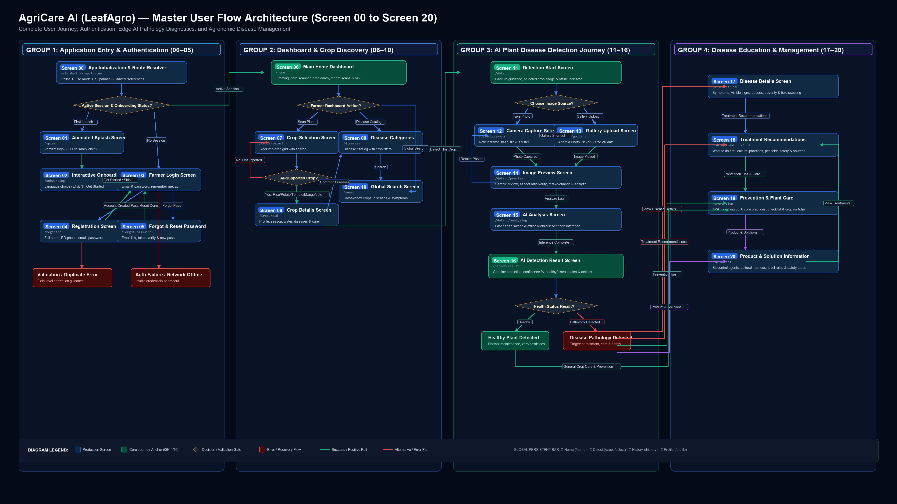

# AgriCare AI — User Manual & Operations Guide
*Comprehensive Step-by-Step Guide for Farmers & Field Officers (English & Bengali)*

---

## 🌟 Application Workflow Overview

AgriCare AI (LeafAgro) provides automated, on-device AI plant pathology diagnosis tailored specifically for Bangladeshi agricultural ecosystems. The user workflow spans **Screens 01 through 07** to guide farmers seamlessly from authentication to crop diagnosis.

---

## 🇬🇧 English Operations Manual

### Screen 01: Animated Splash Screen
1. **Launch:** Open AgriCare AI on your Android or iOS device.
2. **System Initialization:** The application displays the brand logo, version number, and offline TFLite runtime checks.
3. **Session Check:**
   - If an active Supabase session exists, the app navigates directly to **Screen 06: Main Home Dashboard**.
   - If no session is active or first launch, the app transitions smoothly to **Screen 02: Onboarding Screen**.

### Screen 02: Interactive Onboarding
1. **Explore Features:** Swipe through the visual introduction slides highlighting:
   - Instant leaf disease scanning powered by on-device AI.
   - 100% offline edge inference (no internet needed in rural fields).
   - Tailored treatment and prevention recommendations.
2. **Language Toggle:** Tap the language pill in the top-right corner to switch between **English** and **বাংলা**.
3. **Continue:** Tap **Get Started** or **Skip** to navigate to **Screen 03: Login Screen**.

### Screen 03: Farmer Login Screen
1. **Credentials:** Enter your registered email address and account password.
2. **Password Visibility:** Tap the eye icon to toggle password obfuscation.
3. **Actions:**
   - **Login:** Authenticates with Supabase Auth and lands on **Screen 06: Main Home Dashboard**.
   - **Create Account:** Tap **Register** or **Sign Up** to navigate to **Screen 04: Registration Screen**.
   - **Forgot Password:** Tap the **Forgot Password?** link to transition to **Screen 05: Forgot Password Screen**.

### Screen 04: Farmer Registration Screen
1. **Form Details:**
   - **Full Name:** Enter your full legal or preferred name (e.g., *Md. Khorshed Alam*).
   - **Email Address:** Enter a valid email address.
   - **Phone Number:** Enter your Bangladeshi mobile number (prefixed with `+880`).
   - **Password & Confirm Password:** Enter at least 8 characters containing letters and numbers.
2. **Terms & Conditions:** Review and check the *Terms & Conditions and Privacy Policy* agreement checkbox.
3. **Submit:** Tap **Create Account**. A confirmation notification will appear, and you will be routed to the Login screen.

### Screen 05: Password Recovery Screen
1. **Input:** Enter your registered email address into the single recovery field.
2. **Reset Request:** Tap **Send Reset Link**. A secure Supabase password recovery email will be dispatched.
3. **Confirmation:** Follow the instructions sent to your inbox to reset your password and return to Login.

### Screen 06: AgriCare AI Home Dashboard
1. **Header Profile & Greeting:**
   - Dynamic greeting (e.g., *"Good Morning, Farmer!"*) tailored to the time of day.
   - Displays the authenticated farmer's name.
   - Quick access to profile settings via avatar tap and notification center via bell icon.
2. **Hero Section ("Check Your Plant Health"):**
   - High-contrast green gradient card with illustration.
   - Primary Call-To-Action: Tap **Scan Plant** to initiate a disease examination. This opens **Screen 07: Crop Selection Screen**.
3. **Explore Crops Section:**
   - Horizontal gallery showing all 5 AI-supported crops: **Rice (ধান)**, **Potato (আলু)**, **Tomato (টমেটো)**, **Mango (আম)**, and **Jute (পাট)**.
   - Tap any crop to open its detailed botanical guide and common pathology encyclopedia.
4. **Recent Detections Section:**
   - Displays your most recent disease scans sorted chronologically.
   - Shows crop thumbnail, predicted condition, timestamp, and AI confidence level.
   - Tap any record to open the complete diagnosis report.
   - Tap **View All** to navigate to the complete diagnosis history.
5. **Compact Statistics & Quick Actions:**
   - Summary statistics of scans, healthy status ratio, and action shortcuts.

### Screen 07: Crop Selection Screen
1. **Crop Selection Grid:**
   - Visual 2-column grid showing only verified AI-supported crops.
   - Tap a crop card to select it (e.g., *Rice*). The card highlights with a Fresh Green border and check-circle indicator.
2. **Dynamic Search:**
   - Type in the search bar (e.g., *"আলু"* or *"Tomato"*). The grid filters dynamically in real time.
   - If no crops match, an empty-state illustration appears with a **Clear Search** button.
3. **Continue to Crop Details:**
   - Once a valid crop is selected, the bottom **Continue to Scan** button activates.
   - Tapping it preserves your selection in application state and advances to **Screen 08: Crop Details Screen** (`/crops/:id`).

### Screen 08: Crop Details Screen
1. **Top Bar & Actions:**
   - Displays dynamic crop name (e.g. *Rice Profile* / *ধানের বিবরণ*).
   - Bookmark button to save the crop to farmer favorites.
   - Back navigation returns to Crop Selection or Dashboard.
2. **Hero Photograph & Identity:**
   - High-resolution realistic photography with green gradient overlay.
   - English and Bengali names, category badge, and AI-supported indicator with disease count.
3. **Crop Information Cards (Agronomy):**
   - 2-column visual grid showing Category, Growing Season (e.g. Aus, Aman, Boro), Water Need, Sunlight Requirement, Soil Preference, and Growth Duration.
4. **Common Diseases Section:**
   - Horizontal gallery of verified diseases trained in the MobileNetV2 AI model for the selected crop.
   - Each card displays disease name, Bangla name, severity badge (Critical, High, Moderate, Healthy), symptom snippet, and details link to `/diseases/:id`.
5. **Crop Care Tips:**
   - Practical field care guidelines from verified Bangladeshi agricultural research (Water Depth, Balanced Urea, Weed Control, Pest Monitoring).
6. **Prominent Disease Detection CTA:**
   - Fixed bottom action button: **"Detect [Crop] Disease"** (e.g. *"Detect Rice Disease"* / *"ধানের রোগ পরীক্ষা করুন"*).
   - Tapping verifies AI support, sets global crop selection, and advances to the diagnostic scanner (`/detect`).

### Screen 09: Plant Disease Categories Screen
1. **Directory Header & Overview:**
   - Heading: *"Plant Diseases"* / *"ফসলের রোগসমূহ"*.
   - Subtitle: *"Explore common diseases affecting crops."*
   - Accessible from the Home Dashboard or the Crop Details screen.
2. **Crop Filter Selector:**
   - Horizontally scrollable filter chips: **All Crops**, **Rice**, **Potato**, **Tomato**, **Mango**, **Jute**.
   - Tap any crop chip to instantly isolate the pathology catalog for that specific plant.
3. **Bilingual Search Bar:**
   - Real-time search by disease English name, Bangla name, symptoms, or associated crop.
   - Includes one-tap clear search button and immediate local filtering.
4. **Disease Category Cards:**
   - Clean white rounded cards with crop badge, disease titles, severity indicator (`Critical`, `High`, `Moderate`, `Healthy`), and symptom preview.
   - Tapping a disease card navigates to the detailed disease diagnosis and treatment view (`/diseases/:id`).
5. **Smart Empty & Error States:**
   - Contextual empty states for no matching query, no diseases for selected crop, and catalog loading with pull-to-refresh.

### Screen 10: Global Search Screen
1. **Header & Navigation:**
   - Accessible via the search icon on the Home Dashboard header (`/search`) or deep link with query parameters (`/search?q=...`).
   - Clean title: *"Global Search"* / *"সার্বিক অনুসন্ধান"*, subtitle: *"Find crops and diseases"*.
   - Back arrow smoothly returns to the previous screen.
2. **Debounced Search Bar:**
   - Dynamic 300ms debounced input field.
   - Real-time loading indicator while searching across crop catalogs and disease pathologies.
   - Quick one-tap clear button (`X`) to reset query.
3. **Suggestions & Search Ideas:**
   - Curated list of popular search suggestion chips (e.g., *Rice*, *Potato*, *Late Blight*, *Bacterial Leaf Blight*).
   - Tapping any suggestion immediately populates the search bar and executes the query.
4. **Recent Search History:**
   - Automatically records successful searches locally via `SharedPreferences`.
   - Allows individual removal of previous search terms or a one-tap **"Clear All"** action.
5. **Popular Crops Carousel:**
   - Horizontal gallery showcasing all 5 verified AI-supported crops (*Rice*, *Potato*, *Tomato*, *Mango*, *Jute*).
   - Tapping any crop card navigates directly to **Screen 08: Crop Details Screen**.
6. **Dual-Section Search Results:**
   - **Section A (Crops):** Displays matched crops with thumbnails, English and Bengali names, descriptions, and chevron linking to `/crops/:id`.
   - **Section B (Diseases):** Displays matched diseases with crop badges, pathology titles, severity indicators (`Critical`, `High`, `Moderate`, `Healthy`), symptoms previews, and direct navigation to `/diseases/:id`.
7. **Farmer-Friendly Empty State:**
   - When no matching crops or diseases are found, an agricultural zero-result illustration appears with clear guidance and a **Clear Search** button.

### Screen 11: Detection Start Screen
1. **Header & Context:**
   - Heading: *"Detect Plant Disease"* / *"গাছের রোগ নির্ণয়"*.
   - Subtitle: *"Take or upload a clear leaf photo to identify possible plant diseases."*
   - Context Bar: Preserves selected crop information (e.g. *Rice (ধান)*) with disease count and quick *Change* action, or prompts to select a crop for increased accuracy.
2. **Central AI Scanning Illustration:**
   - Botanical healthy leaf with realistic veins and ambient green glow.
   - Agricultural reticle corner brackets framing the leaf sample.
   - Animated laser beam sweeping across the leaf sample with target tracking nodes.
   - Tech pill indicator: *"AI Leaf Scanner • 224x224 Edge Model"*.
3. **Primary Action Cards:**
   - **Take Photo:** One-tap camera launch with permission handling and instant validation.
   - **Choose from Gallery:** One-tap device photo selection with image type/size validation.
   - Tap feedback with loading spinner preventing double-tap submissions.
4. **Image Quality Guide:**
   - 4 practical farmer tips with green icons:
     1. *Use good lighting* (natural/clear light).
     2. *Keep the leaf in focus* (veins and lesion visible).
     3. *Avoid blurry images* (steady hand/phone).
     4. *Capture the affected area clearly* (spots or damage centered).
5. **On-Device Offline Availability Indicator:**
   - Informational status pill confirming offline edge model availability on the device.
6. **Next Step:**
   - Tap **Take Photo** to open the live **Screen 12: Camera Capture Screen** (`/detect/camera`), or **Choose from Gallery** to select an existing leaf photo, proceeding smoothly to `/detect/preview`.

### Screen 12: Camera Capture Screen (Live Viewfinder)
1. **Full-Screen Live Viewfinder:**
   - Real-time live camera feed utilizing the device's rear primary lens by default.
   - Clean aspect-ratio preserving display with dark cinematic background (`#000000`).
2. **Top Control Bar:**
   - **Close Button (Left):** Circular translucent button (`Icons.close_rounded`) that safely closes the camera session and returns to the previous screen.
   - **Active Crop Context (Center):** Displays a green badge with the currently selected crop (e.g., *Rice (ধান)*) confirming the diagnosis target.
   - **Flash Toggle (Right):** Cycles between *Off*, *Torch/On*, and *Auto* with clear icon indicators (`Icons.flash_off_rounded`, `Icons.flash_on_rounded`, `Icons.flash_auto_rounded`). Automatically disables when flash hardware is unsupported.
3. **Leaf Positioning Guide (Reticle):**
   - High-contrast rounded rectangle frame with Fresh Green (`#22C55E`) corner brackets framing the leaf specimen.
   - Subtle leaf watermark in the center.
   - Instruction Banner: *"Place the leaf inside the frame"* and *"Hold steady & avoid glare / heavy shadow"*.
4. **Bottom Control Bar:**
   - **Gallery Shortcut (Left):** One-tap button (`Icons.photo_library_rounded`) allowing farmers to switch directly to device gallery image selection without leaving the camera flow.
   - **Shutter Capture Button (Center):** Ergonomic 80px circular button with white outer ring and Fresh Green gradient inner button. Prevents double-tap submissions and presents a white progress spinner while validating captured photos.
   - **Camera Switch (Right):** One-tap button (`Icons.flip_camera_ios_rounded`) to flip between rear and front-facing cameras when multiple lenses are available.
5. **Hardware & Permission Handling:**
   - Graceful camera permission dialog with direct retry, settings navigation, and gallery fallback.
   - Hardware sensor timeout and error recovery states with clear farmer instructions.
6. **Next Step:**
   - After image capture and validation, smoothly routes to **Image Confirmation & Preview Screen** (`/detect/preview`).

### Screen 13: Gallery Upload Screen (Device Photo Selection)
1. **Screen Header & Crop Context:**
   - Heading: *"Choose a Plant Image"*, Subtitle: *"Select a clear leaf image from your device."*
   - Clean circular back button returning smoothly to the previous screen without triggering picker dialogs.
   - Preserves active crop context badge (e.g., *Rice (ধান)*) confirming the diagnosis target.
2. **Native Android Photo Picker Integration:**
   - Respects Android 13+ native system Photo Picker (`ImagePicker` with `ImageSource.gallery`), providing maximum privacy without requesting broad external storage permissions.
   - Graceful cancellation handling without displaying errors when users dismiss the picker.
   - Comprehensive file validation checking file existence, corrupted zero-byte files, supported formats (`.jpg`, `.jpeg`, `.png`, `.webp`), and size limit (maximum 20MB).
3. **Gallery Selection Area (Initial State):**
   - High-contrast visual illustration featuring photo library iconography with light-green gradient highlights.
   - Heading: *"Select from Gallery"*, with clear farmer explanation text.
   - Prominent **Browse Gallery** button with instant tap feedback and loading spinner.
4. **Selected Image Preview (Post-Selection State):**
   - High-fidelity preview of the actual selected leaf photograph inside a rounded card with Fresh Green (`#22C55E`) border and elevation shadow.
   - Verified badge (*"Ready"*) and metadata pill showing image file name and formatted file size (KB/MB).
   - Prominent **Change Image** outlined button allowing farmers to easily swap the selected leaf photo.
5. **Image Quality Guidelines:**
   - 4 quick tips helping farmers pick diagnostic-quality photos (good lighting, sharp focus, non-blurry, clearly visible lesion).
6. **Continue Action Button:**
   - Ergonomic pinned bottom button: **Continue** (`/detect/preview`).
   - Initially disabled until a valid image is selected; automatically enables with active tactile feedback.
   - Prevents duplicate clicks during preparation.

### Screen 14: Image Preview & Confirmation Screen (Sample Review)
1. **Screen Header & Navigation:**
   - Heading: *"Review Your Image"*, Subtitle: *"Ensure the leaf sample is clear before AI diagnosis."*
   - Accessible circular back button returning smoothly to the previous screen without clearing the selected photo unnecessarily.
2. **Selected Crop Information (`SelectedCropInfo`):**
   - Displays a clean green badge with the crop name (e.g., *Selected Crop: Rice (ধান)*) and AI model status tag (*"AI Ready"*).
   - If no crop was selected, gracefully hides this section without creating empty space.
3. **Large Selected Leaf Photograph (`SelectedLeafImage`):**
   - Spacious, high-fidelity image preview container (height 300px) with 20px rounded corners, subtle green selection border, and soft elevation shadow.
   - Preserves original aspect ratio using `BoxFit.contain` so portrait and landscape photos are never distorted or cropped.
   - Includes a green verified badge (*"Ready"* / *"নমুনা প্রস্তুত"*).
   - Handles missing or corrupted files gracefully with clear error guidance.
4. **Image Quality Status Banner (`ImageQualityStatus`):**
   - Compact real-time file validation status:
     - **Image Ready** (*Green*): Verified and ready for neural network inference.
     - **Image Quality Warning** (*Amber*): File exceeds 15MB, noting preprocessing may take longer.
     - **Unable to Read Image** (*Red*): File missing or zero bytes, prompting user to choose another image.
5. **Image Review Guidance (`ImageReviewInstruction`):**
   - Clear farmer advice: *"Make sure the leaf is clearly visible"* and *"Check that the affected part of the leaf is visible before starting the analysis."*
6. **Secondary Actions (`ImagePreviewActions`):**
   - **Retake Photo**: Camera icon button smoothly returning to Screen 12 (Camera Viewfinder) to capture a new leaf photo.
   - **Change Image**: Gallery icon button opening Screen 13 (Gallery Upload) to pick a different leaf sample.
7. **Primary Action: Analyze Image Button (`AnalyzeImageButton`):**
   - Prominent, full-width bottom button: **Analyze Leaf with AI** with sparkle icon.
   - Disabled if image is corrupted or missing.
   - During analysis, shows a progress spinner and prevents duplicate tap requests.
   - Executes offline TFLite inference and routes smoothly to **Screen 15: AI Analysis Screen** (`/detect/analyzing`).

### Screen 15: AI Analysis Screen (Neural Network Inference)
1. **Uncluttered Branding Header (`AnalyzingHeader`):**
   - Clean top bar displaying the green AgriCare AI leaf icon and title, omitting back navigation to prevent accidental cancellation during active inference.
2. **Selected Plant Leaf Photograph & AI Scanning Visualization (`ScanningImageView`):**
   - High-fidelity container displaying the actual leaf image with original aspect ratio intact (`BoxFit.contain`).
   - Four glowing Fresh Green (`#22C55E`) corner brackets framing the leaf.
   - Smooth animated green laser scanning line with gradient trail sweeping across the leaf surface.
   - Optional target crop badge (e.g., *Target Crop: Rice (ধান)*).
3. **Status Feedback (`AnalyzingStatusSection`):**
   - **Exact Main Heading:** *"Analyzing Your Plant"* / *"আপনার গাছ বিশ্লেষণ করা হচ্ছে"*
   - **Exact Subtitle:** *"Our AI model is examining the leaf image."* / *"আমাদের AI মডেল পাতার ছবিটি পর্যবেক্ষণ করছে।"*
   - **Indeterminate Progress Indicator:** Truthful green progress bar (non-fabricated, no fake percentages).
   - **Status Text:** *"Processing image on your device"* with pulsing green indicator.
   - **Genuine Offline AI Badge:** *"On-device AI • Offline"* confirming local TFLite edge model computation.
4. **Resilient Failure & Recovery View (`AnalyzingErrorView`):**
   - Displayed if neural network computation fails:
     - Friendly message: *"We couldn't analyze this image. Please try again."*
     - **Retry Analysis** button to re-trigger local inference.
     - **Choose Another Image** button returning to Screen 14.
5. **Seamless Success Navigation:**
   - On completion with valid pathology prediction, stops animation and transitions to **Screen 16: Diagnosis Result Screen** (`/detect/result`).

### Screen 16: AI Detection Result Screen (Diagnostic Findings & Advisory)
1. **Header Navigation (`DetectionResultHeader`):**
   - Displays screen title *"Analysis Result"* / *"বিশ্লেষণ ফলাফল"* with supportive subtitle.
   - Close (`X`) button in the top corner for fast, safe return to Home Dashboard (`/home`).
2. **Result Image Card (`ResultImageCard`):**
   - High-fidelity container displaying the examined leaf image with preserved original aspect ratio (`BoxFit.contain`).
   - Floating diagnostic badge overlaid directly on the image indicating quick health status.
   - Bottom crop identifier banner (e.g., *"Target Crop: Rice (ধান)"*).
3. **Prediction Status Badge (`PredictionStatusBadge`):**
   - **Healthy State:** Soft emerald badge (`#DCFCE7`), dark green border (`#16A34A`), checkmark icon, and *"Healthy Plant"* label.
   - **Disease Detected:** Amber alert badge (`#FEF3C7`), amber border (`#D97706`), warning icon, and *"Disease Detected"* label.
4. **AI Prediction Card (`AIPredictionCard`):**
   - Primary diagnostic headline: Genuine predicted disease name in English and Bengali (or *"Healthy Plant / সুস্থ গাছ"*).
   - Exact numerical confidence score (e.g., *"94.2% Confidence"*).
   - Horizontal match strength progress bar matching model confidence.
   - **Confidence vs. Certainty Distinction Note:** Reassuring explanation clarifying that confidence reflects pattern matching strength from training data, not absolute laboratory certainty.
   - Verified summary: Sourced directly from local disease catalog symptoms; zero fabricated content.
5. **Contextual Action Sections:**
   - **When Disease Detected (`DiseaseActionsSection`):**
     - **Treatment Recommendations:** Direct navigation to verified cultural and chemical treatment guidance (`/recommendations/:id`).
     - **View Disease Details:** In-depth biological profile, pathogen lifecycle, and field symptoms (`/diseases/:id`).
     - **Prevention Tips:** Preventive practices and field sanitation guidelines (`/prevention/:id`).
   - **When Healthy (`HealthyActionsSection`):**
     - Reassuring confirmation card: *"Your plant looks healthy!"*
     - Best-practice crop care, optimal irrigation, and seasonal maintenance advice.
     - Strictly omits pesticide and chemical treatment suggestions.
6. **Save Result to History (`SaveResultButton`):**
   - Stores image path, prediction label, confidence, crop metadata, and timestamp into local SQLite cache and syncs with Supabase.
   - Interactive state machine: *Initial* ("Save Result") → *Saving* (loader) → *Saved* ("Saved to History" with check icon, disabled) → *Error* (retry prompt).
7. **Scan Another Plant (`ScanAnotherButton`):**
   - Full-width Fresh Green (`#22C55E`) primary CTA.
   - Clears active detection session and returns user to Detection Start Screen (`/detect`).
8. **Legal & Agronomic Disclaimer (`DetectionDisclaimer`):**
   - Prominent cautionary notice reminding farmers that AI assessments are advisory estimates and should be confirmed by local Upazila agricultural extension officers when severe.

### Screen 17: Disease Details Screen (Botanical Profile & Field Education)
1. **Header Navigation (`DiseaseDetailHeader`):**
   - Clean top bar displaying the disease title, back navigation arrow returning to previous screen (`context.pop()` or `/diseases`), and AgriCare AI badge.
2. **Hero Section & Verified Visuals (`DiseaseHeroSection`):**
   - Prominent disease headline in English and Bengali.
   - Host crop tag (e.g., *Rice (ধান)*) with crop icon.
   - Status badge (*Infected* vs. *Healthy Plant*).
   - Rounded disease photography container preserving proper aspect ratio (`BoxFit.cover`), with neutral agricultural fallback when image is unavailable.
   - **Sample Content Banner:** Visibly labels test/demo records with *"Sample Information – For Demonstration Only"*; strictly omitted from verified production records.
3. **Overview & Host Impact (`DiseaseOverviewCard`):**
   - Simple, farmer-friendly summary explaining the pathogen, affected plant parts, and yield implications in everyday language.
4. **Common Symptoms Checklist (`DiseaseSymptomsCard`):**
   - Structured checklist of symptoms formatted from verified database records with thematic icons.
   - Friendly unavailable state if no symptoms are listed.
5. **Visible Signs on Leaves (`DiseaseVisibleSignsCard`):**
   - Field scouting markers to help farmers inspect their plants (e.g. water-soaked margins, concentric ring target-boards, chlorotic halos, or fuzzy downy mold).
6. **Possible Causes & Vectors (`DiseaseCausesCard`):**
   - Explains the underlying organism (fungus, bacteria, oomycete) and environmental contributing factors (humidity, rain, fog, soil moisture).
7. **Disease Severity & Literary Risk (`DiseaseSeverityCard`):**
   - Displays general botanical severity only when supported, accompanied by a prominent notice clarifying that this is literature risk classification, not an individual plant assessment.
8. **Action Navigation Buttons (`DiseaseActionButtons`):**
   - **Treatment Recommendations:** Direct route to verified recovery and pesticide guidelines (`/recommendations/:id`).
   - **Prevention Tips & Care:** Direct route to agronomic field care and sanitation protocols (`/prevention/:id`).
9. **Related Crop Diseases (`RelatedDiseasesSection`):**
   - Horizontal browsing cards showing other verified diseases affecting the same crop for quick cross-comparison.

### Screen 18: Treatment Recommendations Screen (Agricultural Recovery & Chemical Safety)
1. **Header Navigation (`TreatmentHeader`):**
   - Clean top bar displaying the screen title, back navigation arrow returning to previous screen (`context.pop()`), medical services icon, and LeafAgro branding badge.
2. **Detected Disease Summary Card (`DetectedDiseaseSummaryCard`):**
   - Shows detected disease name (English & Bengali), host crop, original leaf photograph thumbnail, and AI confidence pattern-match score (e.g. *94.2%*).
   - Prominent disclaimer clarifying that AI predictions are visual estimates, not a confirmed laboratory diagnosis.
   - Visibly labels sample or demo records with *"Sample Guidance – For Demonstration Only"*; omitted on verified production records.
3. **Immediate Actions ("What to Do First") (`ImmediateActionsCard`):**
   - Numbered action cards guiding field scouting, isolation of stagnant irrigation water, and consultation with the local Upazila extension officer without prescribing destructive measures.
4. **Agricultural Management Practices (`AgriculturalPracticesSection`):**
   - Cultural management cards covering field and bund sanitation, regulated irrigation/drainage, and balanced fertilizer (nitrogen restriction and potassium reinforcement).
5. **Verified Treatment Options (`VerifiedTreatmentsSection`):**
   - Sourced from verified publications of BRRI, BARI, and DAE Bangladesh.
   - Strictly enforces chemical safety rules: zero invented brands, zero fabricated dosages, and mandatory instructions to follow the registered product label and local DAE guidance.
   - Displays a clear advisory message when verified chemical guidance is unavailable.
6. **Step-by-Step Action Plan (`StepByStepRecommendationsCard`):**
   - Numbered progression: Step 1 (Inspect the Crop), Step 2 (Apply Cultural Management), Step 3 (Consult Verified Guidance), and Step 4 (Monitor Progress Regularly).
7. **Important Safety Reminders (`SafeHandlingRemindersCard`):**
   - Protective equipment (mask, gloves), child and livestock chemical isolation, prohibition against food/drink container storage, and mandatory agricultural officer consultation notice.
8. **Source Verification (`TreatmentSourcesSection`):**
   - Attributes agronomic information to official institutes (BRRI, BARI, BJRI, DAE).
9. **Prevention Navigation (`PreventionNavButton`):**
   - Direct button routing to long-term prevention protocols (`/prevention/:id`).

### Screen 19: Prevention & Plant Care Screen (Crop Disease Prevention & Management)
1. **Header Navigation (`PreventionHeader`):**
   - Clean top bar displaying the screen title (*"Prevention & Plant Care"* / *"রোগ প্রতিরোধ ও যত্ন"*), shield icon (`Icons.shield_outlined`), back navigation arrow returning to previous screen (`context.pop()`), and LeafAgro branding badge.
2. **Healthy Crop Hero Banner (`HealthyCropHeroSection`):**
   - High-contrast emerald card featuring a healthy crop photograph, protective shield badge, headline (*"Keep Your Crops Healthy"*), and a transparent, realistic risk-mitigation disclaimer stating that good prevention practices significantly reduce disease risk but cannot guarantee complete immunity.
3. **Active Crop Context & Crop Switcher (`SelectedCropContextCard`):**
   - Identifies the active crop profile (e.g. *Rice (ধান)*) with botanical crop avatar.
   - Shows active disease context pill when navigated from detection results or treatment recommendations.
   - Horizontal choice-chip bar allowing farmers to seamlessly switch guidance across all 5 AI-supported crops: Rice, Potato, Tomato, Mango, and Jute.
4. **Essential Preventive Practices (`EssentialPracticesSection`):**
   - 6 foundational agricultural management cards formatted in a clean 2-column grid:
     1. **Crop Monitoring & Scouting**: Early symptom scouting and field boundary inspection.
     2. **Optimal Irrigation & Drainage**: Proper watering depth and prevention of stagnant surface water.
     3. **Field Sanitation**: Removal of infected debris, weeds, and alternate hosts.
     4. **Crop Rotation**: Breaking pathogen lifecycles by avoiding continuous monoculture.
     5. **Spacing & Ventilation**: Optimal plant spacing for air circulation and rapid canopy drying.
     6. **Certified Quality Seeds**: Sourcing clean, certified pathogen-free seeds and seedlings.
5. **Crop-Specific Agronomic Care (`CropSpecificAdviceSection`):**
   - Verified agronomic advice tailored specifically to the active crop:
     - **Rice**: AWD irrigation, balanced N-P-K-Zn, weeding, water depth control.
     - **Potato**: Well-drained raised beds, earthing up, certified tubers, humidity scouting.
     - **Tomato**: Trellising/staking, drip or basin watering, mulching, air flow pruning.
     - **Mango**: Canopy pruning, sanitation of fallen fruit, post-harvest sanitation.
     - **Jute**: Soil moisture management, early thinning, weeding, drainage channels.
6. **Disease-Specific Prevention Protocol (`DiseaseSpecificPreventionSection`):**
   - Dynamically loaded when opened from a specific disease context (Screen 16, 17, or 18).
   - Sourced from verified agronomic research (BRRI, BARI, DAE).
   - Strictly omitted when browsing general crop care, avoiding irrelevant chemical or pathogen clutter.
7. **Interactive Prevention Checklist (`PreventionChecklistCard`):**
   - Interactive actionable checklist with real-time checkbox toggles.
   - Live completion counter (e.g. *"3 of 6 completed"*) and dynamic progress bar.
   - Local persistence using `SharedPreferences` keyed per crop (`prevention_checklist_${cropId}`), preserving farmer progress across app launches.
8. **Resilient Fallback & Shimmer Loading:**
   - `PreventionSkeleton`: Smooth shimmering skeleton layout while catalog/recommendations load.
   - `PreventionNotFoundView`: Friendly fallback card with one-tap reset button if an invalid crop/disease ID is requested.

---

## 🇧🇩 বাংলা ব্যবহারিক নির্দেশিকা (কৃষক ও মাঠ কর্মকর্তাদের জন্য)

### স্ক্রিন ০১: অ্যানিমেটেড স্প্ল্যাশ স্ক্রিন
১. **অ্যাপ চালু:** আপনার ফোনে AgriCare AI অ্যাপটি ওপেন করুন।
২. **সিস্টেম লোডিং:** অ্যাপটির লোগো প্রদর্শিত হবে এবং অফলাইন AI মডেল স্বয়ংক্রিয়ভাবে প্রস্তুত হবে।
৩. **লগইন পরীক্ষা:**
   - পূর্ববর্তী লগইন থাকলে সরাসরি **স্ক্রিন ০৬: মূল ড্যাশবোর্ড**-এ নিয়ে যাবে।
   - প্রথমবার চালু করলে **স্ক্রিন ০২: অনবোর্ডিং** পেজে যাবে।

### স্ক্রিন ০২: পরিচিতি ও অনবোর্ডিং
১. **ফিচারসমূহ দেখুন:** পাতা সোয়াইপ করে অ্যাপের মূল সুবিধাগুলো জানুন:
   - মোবাইল থেকেই তাত্ক্ষণিক ফসলের রোগ নির্ণয়।
   - সম্পূর্ণ ইন্টারনেট ছাড়া অফলাইনে কৃত্রিম বুদ্ধিমত্তা চালনা।
   - অনুমোদিত সঠিক কৃষি সমাধান ও প্রতিষেধক পরামর্শ।
২. **ভাষা পরিবর্তন:** উপরে ডানপাশের ভাষা বাটন চেপে **বাংলা** বা **English** নির্বাচন করুন।
৩. **পরবর্তী ধাপ:** **শুরু করুন (Get Started)** বাটনে চাপ দিয়ে **স্ক্রিন ০৩: লগইন** পেজে প্রবেশ করুন।

### স্ক্রিন ০৩: কৃষক লগইন স্ক্রিন
১. **লগইন তথ্য:** আপনার নিবন্ধিত ইমেইল ও পাসওয়ার্ড প্রদান করুন।
২. **পাসওয়ার্ড দেখা:** চোখের আইকন চেপে পাসওয়ার্ড চেক করতে পারেন।
৩. **বিকল্পসমূহ:**
   - **লগইন:** সঠিক তথ্য দিয়ে **স্ক্রিন ০৬: ড্যাশবোর্ড**-এ প্রবেশ করুন।
   - **নতুন অ্যাকাউন্ট:** নিচে **রেজিস্টার** বাটনে চাপ দিয়ে **স্ক্রিন ০৪**-এ যান।
   - **পাসওয়ার্ড ভুলে গেলে:** **Forgot Password?** বাটনে চাপ দিন।

### স্ক্রিন ০৪: নতুন অ্যাকাউন্ট রেজিস্ট্রেশন স্ক্রিন
১. **প্রয়োজনীয় তথ্য:**
   - **পুরো নাম:** আপনার নাম লিখুন (যেমন: *মোঃ খোরশেদ আলম*)।
   - **ইমেইল ঠিকানা:** সঠিক ইমেইল প্রদান করুন।
   - **মোবাইল নম্বর:** বাংলাদেশি মোবাইল নম্বর (+880 সহ)।
   - **পাসওয়ার্ড ও কনফার্ম পাসওয়ার্ড:** কমপক্ষে ৮ অক্ষরের বর্ণ ও সংখ্যাযুক্ত শক্তিশালী পাসওয়ার্ড দিন।
২. **শর্তাবলী সম্মতি:** *শর্তাবলী ও নীতিমালা* চেক বক্সে টিক চিহ্ন দিন।
৩. **অ্যাকাউন্ট তৈরি:** **Create Account** বাটনে চাপ দিন। সফল হওয়ার পর লগইন পেজে নিয়ে যাবে।

### স্ক্রিন ০৫: পাসওয়ার্ড পুনরুদ্ধার স্ক্রিন
১. **ইমেইল প্রদান:** অ্যাকাউন্টের ইমেইল ঠিকানাটি লিখুন।
২. **রিসেট লিংক পাঠান:** **Send Reset Link** বাটনে চাপ দিন।
৩. **ইমেইল চেক করুন:** আপনার ইনবক্সে আসা নির্দেশিকা অনুসরণ করে নতুন পাসওয়ার্ড সেট করুন।

### স্ক্রিন ০৬: AgriCare AI মূল ড্যাশবোর্ড
১. **স্বাগতম ও প্রোফাইল হেডার:**
   - দিনের সময়ের সাথে সামঞ্জস্যপূর্ণ শুভেচ্ছা বার্তা (যেমন: *"শুভ সকাল, কৃষক ভাই!"*)।
   - কৃষকের নাম এবং প্রোফাইল ছবি ও নোটিফিকেশন বেল।
২. **রোগ নির্ণয় হিরো কার্ড ("Check Your Plant Health"):**
   - আকর্ষণীয় সবুজ গ্র্যাডিয়েন্ট কার্ড।
   - বড় **Scan Plant (ফসল পরীক্ষা করুন)** বাটনে চাপ দিয়ে সরাসরি **স্ক্রিন ০৭: ফসল নির্বাচন** স্ক্রিনে যান।
৩. **ফসল এক্সপ্লোর সেকশন:**
   - AI সমর্থিত ৫টি ফসলের ছবি ও তালিকা: **ধান (Rice)**, **আলু (Potato)**, **টমেটো (Tomato)**, **আম (Mango)**, এবং **পাট (Jute)**।
   - যেকোনো ফসলে চাপ দিয়ে তার সাধারণ রোগ ও যত্ন নির্দেশিকা দেখুন।
৪. **সাম্প্রতিক পরীক্ষা রেকর্ড (Recent Detections):**
   - আপনার স্ক্যান করা পূর্বের রোগ নির্ণয়ের তালিকা।
   - রোগের নাম, তারিখ এবং AI কনফিডেন্স স্কোর প্রদর্শিত হয়।
   - বিস্তারিত দেখতে যেকোনো রেকর্ডে চাপ দিন অথবা সব দেখতে **View All** চাপুন।

### স্ক্রিন ০৭: ফসল নির্বাচন স্ক্রিন (Crop Selection)
১. **ফসল গ্রিড:**
   - AI মডেল দ্বারা সমর্থিত শস্যের আধুনিক দুই কলাম গ্রিড।
   - যে ফসলটি পরীক্ষা করতে চান তাতে চাপ দিন (যেমন: *ধান*)। সাথে সাথে সবুজ বর্ডার ও টিক চিহ্ন দেখা যাবে।
২. **স্মার্ট সার্চ বার:**
   - বাংলায় বা ইংরেজিতে ফসলের নাম লিখে সহজে খুঁজুন (যেমন: *"আলু"* বা *"Tomato"*)।
   - কোনো ফসল না মিললে **Clear Search** বাটন চেপে পুনরায় পুরো তালিকা দেখুন।
৩. **পরবর্তী ধাপে যান:**
   - ফসল নির্বাচন সম্পন্ন হলে নিচের **Continue to Scan (পরবর্তী ধাপ)** বাটনটি সক্রিয় হবে।
   - বাটনে চাপ দিয়ে সরাসরি **স্ক্রিন ০৮: ফসলের বিবরণ ও রোগ তালিকা** পেজে যান।

### স্ক্রিন ০৮: ফসলের বিস্তারিত তথ্য স্ক্রিন (Crop Details Screen)
১. **হেডার ও বুকমার্ক:**
   - নির্বাচিত ফসলের নাম (যেমন: *ধানের বিবরণ*) ও পছন্দের তালিকায় সংরক্ষণের জন্য বুকমার্ক বাটন।
   - ব্যাক বাটন চেপে পুনরায় ফসল পরিবর্তন করা যায়।
২. **হিরো ফটোগ্রাফি ও মূল তথ্য:**
   - ফসলের বড় ছবি, বাংলা ও ইংরেজি নাম, ফসলের সারসংক্ষেপ ও AI সমর্থিত রোগের সংখ্যার ব্যাজ।
৩. **কৃষি তথ্য কার্ড (Crop Information):**
   - ২-কলামের তথ্য কার্ড: ফসলের বিভাগ, চাষের মৌসুম (আউশ, আমন, বোরো), পানির চাহিদা, সূর্যালোক, মাটির ধরন ও ফসল পাকার সময়।
৪. **পরিচিত রোগসমূহ (Common Diseases):**
   - উক্ত ফসলের জন্য প্রশিক্ষিত AI মডেলের রোগসমূহের গ্যালারি (যেমন ধানের জন্য: ব্যাকটেরিয়াল লিফ ব্লাইট, বাদামী দাগ, পাতার স্মাট ও সুস্থ পাতা)।
   - তীব্রতার মাত্রা (মারাত্মক, উচ্চ, মাঝারি, সুস্থ) এবং বিস্তারিত দেখতে কার্ডে চাপ দিন।
৫. **ফসল পরিচর্যার পরামর্শ (Crop Care Tips):**
   - জমিতে পানির গভীরতা, সুষম ইউরিয়া সার প্রয়োগ, নিড়ানি ও রোগ পর্যবেক্ষণের নির্ভরযোগ্য পরামর্শ।
৬. **রোগ নির্ণয় বাটন (Detect Crop Disease):**
   - স্ক্রিনের নিচে বড় সবুজ বাটন: **"ধানের রোগ পরীক্ষা করুন"** (অন্যান্য ফসলের ক্ষেত্রে ফসলের নাম অনুযায়ী পরিবর্তিত হবে)।
   - বাটনে চাপ দিলে সরাসরি পাতার ছবি গ্রহণ ও রোগ নির্ণয় পেজে নিয়ে যাবে।

### স্ক্রিন ০৯: উদ্ভিদের রোগ ক্যাটাগরি ও তালিকা স্ক্রিন (Plant Disease Categories)
১. **ডিরেক্টরি হেডার:**
   - শিরোনাম: *"ফসলের রোগসমূহ"* এবং ব্যাক নেভিগেশন বাটন।
   - ড্যাশবোর্ড বা ফসলের বিবরণী পেজ থেকে সহজেই প্রবেশ করা যায়।
২. **ফসল ফিল্টার চিপস:**
   - অনুভূমিকভাবে স্ক্রোলযোগ্য ফিল্টার: **সকল ফসল**, **ধান**, **আলু**, **টমেটো**, **আম**, **পাট**।
   - যেকোনো ফসলে চাপ দিয়ে মুহূর্তেই সেই ফসলের রোগ তালিকা আলাদা করা যায়।
৩. **দ্বিভাষিক সার্চ বার:**
   - রোগের নাম (বাংলা বা ইংরেজি), ফসলের নাম বা লক্ষণ লিখে সরাসরি রিয়েল-টাইম সার্চ।
   - ক্রস (X) বাটন চেপে এক ক্লিকে সার্চ ক্লিয়ার করার সুবিধা।
৪. **রোগ ক্যাটাগরি কার্ড:**
   - প্রতিটি কার্ডে ফসলের ব্যাজ, রোগের ইংরেজি ও বাংলা নাম, তীব্রতার মাত্রা (মারাত্মক, উচ্চ, মাঝারি, সুস্থ) ও ক্ষতিকর লক্ষণের সারসংক্ষেপ প্রদর্শিত হয়।
   - যেকোনো কার্ডে চাপ দিলে রোগটির সম্পূর্ণ সমাধান ও প্রতিরোধ সংক্রান্ত পেজে নিয়ে যায়।
৫. **স্মার্ট এম্পটি স্টেট:**
   - কোনো ফলাফল না মিললে বা ডাটাবেজ তথ্য না থাকলে বন্ধুত্বপূর্ণ নোটিফিকেশন ও ফিল্টার রিসেট বাটন প্রদর্শিত হয়।

### স্ক্রিন ১০: সার্বিক অনুসন্ধান স্ক্রিন (Global Search Screen)
১. **হেডার ও নেভিগেশন:**
   - মূল ড্যাশবোর্ডের সার্চ আইকন বাটন থেকে সহজেই প্রবেশ করা যায় (`/search`)।
   - শিরোনাম: *"সার্বিক অনুসন্ধান"*, উপশিরোনাম: *"ফসল ও রোগের তথ্য খুঁজুন"* এবং ব্যাক বাটন।
২. **স্মার্ট সার্চ ইনপুট:**
   - ৩০০ মিলি-সেকেন্ড ডিবাউন্সযুক্ত স্বয়ংক্রিয় অনুসন্ধান বার।
   - টাইপ করার সাথে সাথে লোডিং স্পিনার ও তাৎক্ষণিক ফিল্টারিং।
   - এক চাপে সার্চ মোছার জন্য ক্রস (X) বাটন।
৩. **অনুসন্ধান পরামর্শ (Suggestions):**
   - ডাটাবেজের জনপ্রিয় বিষয়বস্তুর চিপস (যেমন: *ধান*, *আলু*, *নাবী ধসা রোগ*, *টমেটো*, ইত্যাদি)।
   - যেকোনো চিপে চাপ দিলে সাথে সাথে সেই বিষয়ে স্বয়ংক্রিয় অনুসন্ধান শুরু হয়।
৪. **সাম্প্রতিক অনুসন্ধানের ইতিহাস:**
   - কৃষকের পূর্ববর্তী অনুসন্ধানগুলো মেমোরিতে সংরক্ষিত থাকে।
   - একক রেকর্ড মুছে ফেলার পাশাপাশি **সব মুছুন (Clear All)** বাটন দিয়ে সব ইতিহাস একবারে খালি করা যায়।
৫. **জনপ্রিয় ফসল গ্যালারি:**
   - AI সমর্থিত ৫টি শস্যের অনুভূমিক স্লাইডার (*ধান*, *আলু*, *টমেটো*, *আম*, *পাট*)।
   - কার্ডে চাপ দিলে সরাসরি **স্ক্রিন ০৮: ফসলের বিবরণ ও রোগ তালিকা** পেজে নিয়ে যায়।
৬. **দ্বি-বিভক্ত ফলাফল তালিকা:**
   - **সেকশন ক (ফসল):** ছবির থাম্বনেইল, বাংলা ও ইংরেজি নাম, কৃষি বিবরণ ও বিস্তারিত যাওয়ার তীরচিহ্ন।
   - **সেকশন খ (রোগসমূহ):** সংশ্লিষ্ট ফসলের ব্যাজ, রোগের নাম, তীব্রতার মাত্রা (মারাত্মক, উচ্চ, মাঝারি, সুস্থ), লক্ষণসমূহ ও চিকিৎসা পেজের লিংক।
৭. **তথ্য না পাওয়ার সহজ বার্তা (Empty State):**
   - কোনো ফলাফল না পাওয়া গেলে বন্ধুত্বপূর্ণ কৃষক বার্তা ও **"অনুসন্ধান মুছুন"** বাটন প্রদর্শিত হয়।

### স্ক্রিন ১১: রোগ পরীক্ষা শুরুর স্ক্রিন (Detection Start Screen)
১. **হেডার ও শস্যের তথ্য:**
   - শিরোনাম: *"গাছের রোগ নির্ণয়"* ও উপশিরোনাম।
   - পূর্বে নির্বাচিত ফসল থাকলে (যেমন: *ধান*) তার নাম, সমর্থিত রোগের সংখ্যা ও *পরিবর্তন* বাটন প্রদর্শিত হয়।
২. **কেন্দ্রীয় AI স্ক্যানিং ইলাস্ট্রেশন:**
   - পাতার বাস্তবসম্মত শিরা ও সবুজ আভা সহ আধুনিক বোটানিক্যাল আর্ট।
   - কৃষি ভিউফাইন্ডার কর্নার ব্র্যাকেট ও অ্যানিমেটেড লেজার স্ক্যানিং রশ্মি।
   - এজ মডেল নির্দেশক: *"AI পাতা স্ক্যানার • ২২৪x২২৪ এজ মডেল"|।
৩. **দুটি প্রধান অ্যাকশন কার্ড:**
   - **ছবি তুলুন (Take Photo):** ফোনের ক্যামেরা চালু করে সরাসরি পাতার ছবি তোলার সুবিধা।
   - **গ্যালারি থেকে নির্বাচন (Choose from Gallery):** ফোন মেমোরি থেকে পূর্বে তোলা পাতার ছবি আপলোড।
   - ডাবল-ট্যাপ প্রতিরোধ ও স্পষ্ট লোডিং নির্দেশক।
৪. **ছবির মান বৃদ্ধির নির্দেশিকা (Quality Guide):**
   - কৃষকদের জন্য ৪টি সহজ পরামর্শ:
     ১. *পর্যাপ্ত আলো ব্যবহার করুন*
     ২. *পাতার ওপর ফোকাস রাখুন*
     ৩. *ঝাপসা ছবি তোলা এড়িয়ে চলুন*
     ৪. *আক্রান্ত অংশ সুস্পষ্ট রাখুন*
৫. **অফলাইন AI স্ট্যাটাস ব্যাজ:**
   - ডিভাইসেই সম্পূর্ণ ইন্টারনেট ছাড়া রোগ নির্ণয় কার্যকর থাকার নিশ্চয়তা।
৬. **পরবর্তী ধাপ:**
   - **ছবি তুলুন** বাটনে চাপ দিয়ে **স্ক্রিন ১২: ক্যামেরা ক্যাপচার স্ক্রিন** (`/detect/camera`)-এ প্রবেশ করুন অথবা **গ্যালারি** থেকে পাতা নির্বাচন করে সরাসরি `/detect/preview` পেজে যান।

### স্ক্রিন ১২: ক্যামেরা ক্যাপচার স্ক্রিন (লাইভ ভিউফাইন্ডার)
১. **ফুল-স্ক্রিন লাইভ ক্যামেরা ভিউফাইন্ডার:**
   - ডিফল্টভাবে ফোনের ব্যাক বা প্রধান ক্যামেরা ব্যবহার করে সরাসরি লাইভ প্রিভিউ প্রদান করে।
   - সঠিক অ্যাসপেক্ট রেশিও এবং মাঠে রোদে ব্যবহারের উপযোগী ডার্ক ব্যাকগ্রাউন্ড (`#000000`)।
২. **টপ কন্ট্রোল বার:**
   - **বাতিল বাটন (বাম):** ক্যামেরা সেশন বন্ধ করে পূর্বের স্ক্রিনে ফেরার জন্য ক্রস বাটন (`Icons.close_rounded`)।
   - **নির্বাচিত ফসল নির্দেশক (মাঝখান):** বর্তমানে নির্বাচিত ফসলের ব্যাজ (যেমন: *ধান (Rice)*) প্রদর্শন করে।
   - **ফ্ল্যাশ কন্ট্রোল (ডান):** ফ্ল্যাশ বন্ধ (Off), টর্চ চালু (Torch), ও অটো (Auto) মোডে চক্রাকারে পরিবর্তনের বাটন। ফ্ল্যাশ হার্ডওয়্যার না থাকলে স্বয়ংক্রিয়ভাবে অক্ষম হয়ে যায়।
৩. **পাতা স্থাপনের নির্দেশিকা ফ্রেম (Viewfinder Reticle):**
   - সবুজ কর্নার অ্যাকসেন্ট সহ গোল কোণাকৃতির ভিউফাইন্ডার রেটিকল।
   - মাঝখানে সূক্ষ্ম পাতার জলছাপ।
   - কৃষকের জন্য পরিষ্কার নির্দেশনা: *"পাতার অংশটি ফ্রেমের ভেতরে রাখুন"* এবং *"হাত স্থির রাখুন এবং ঝাপসা বা আলো এড়ান"*।
৪. **বটম কন্ট্রোল বার:**
   - **গ্যালারি শর্টকাট (বাম):** সরাসরি গ্যালারি থেকে ছবি বেছে নেওয়ার জন্য বাটন।
   - **ক্যাপচার বাটন (মাঝখান):** ৮০ পিক্সেলের বড় বৃত্তাকার শাটার বাটন (সাদা রিং ও সতেজ সবুজ কোর)। ডাবল-ট্যাপ প্রতিরোধ ও স্পষ্ট লোডিং স্পিনার।
   - **ক্যামেরা পরিবর্তন (ডান):** ফ্রন্ট ও ব্যাক ক্যামেরার মধ্যে পরিবর্তন করার বাটন।
৫. **অনুমতি ও হার্ডওয়্যার নিয়ন্ত্রণ:**
   - ক্যামেরা পারমিশন না থাকলে বন্ধুত্বপূর্ণ বার্তা, সেটিংস খোলার অপশন এবং গ্যালারি বিকল্প।
   - হার্ডওয়্যার সংযোগে সমস্যা হলে স্পষ্ট ত্রুটি বার্তা ও পুনরায় চেষ্টার বাটন।
৬. **পরবর্তী ধাপ:**
   - ছবি তোলার পর স্বয়ংক্রিয়ভাবে **ছবি নিশ্চিতকরণ ও প্রিভিউ** (`/detect/preview`) পেজে নিয়ে যায়।

### স্ক্রিন ১৩: গ্যালারি আপলোড স্ক্রিন (ডিভাইস থেকে ছবি নির্বাচন)
১. **হেডার ও শস্যের তথ্য:**
   - শিরোনাম: *"গাছের ছবি নির্বাচন করুন"*, উপশিরোনাম: *"আপনার ডিভাইস থেকে পাতার স্পষ্ট ছবি নির্বাচন করুন।"*
   - ব্যাক বাটন চেপে ছবি নির্বাচন প্রক্রিয়া ছাড়া পূর্বের পেজে ফিরে যাওয়ার সুবিধা।
   - সক্রিয় ফসলের ব্যাজ (যেমন: *ধান (Rice)*) প্রদর্শন করে।
২. **অ্যান্ড্রয়েড নেটিভ ফটো পিকার ইন্টিগ্রেশন:**
   - অ্যান্ড্রয়েড ১৩+ সিস্টেমের নেটিভ ফটো পিকার ব্যবহার করায় মেমোরির পূর্ণ পারমিশন চাওয়ার প্রয়োজন হয় না।
   - কৃষক পিকার বন্ধ করলে কোনো অপ্রয়োজনীয় ত্রুটি না দেখিয়ে স্বাভাবিক অবস্থা বজায় রাখা হয়।
   - ছবির সাইজ (সর্বোচ্চ ২০ মেগাবাইট) এবং ফরম্যাট (`.jpg`, `.jpeg`, `.png`, `.webp`) স্বয়ংক্রিয়ভাবে যাচাই করা হয়।
৩. **গ্যালারি নির্বাচন এরিয়া (প্রাথমিক অবস্থা):**
   - হালকা সবুজ গ্রেডিয়েন্ট ও ফটো লাইব্রেরি আইকন সম্বলিত আকর্ষণীয় কার্ড।
   - শিরোনাম: *"গ্যালারি থেকে নির্বাচন করুন"* ও ব্যাখ্যা।
   - বড় **গ্যালারি ব্রাউজ করুন** বাটন।
৪. **নির্বাচিত ছবির প্রিভিউ (ছবি নির্বাচনের পর):**
   - বাস্তব নির্বাচিত পাতার ছবির প্রিভিউ কার্ড (সতেজ সবুজ বর্ডার ও শ্যাডো সহ)।
   - যাচাইকৃত ব্যাজ (*"যাচাইকৃত"*) এবং ছবির নাম ও সাইজ (KB/MB)।
   - **অন্য ছবি পরিবর্তন করুন** বাটন চেপে নতুন ছবি নির্বাচনের সুযোগ।
৫. **ছবির গুণমান নির্দেশিকা:**
   - পর্যাপ্ত আলো, সঠিক ফোকাস, ঝাপসা না হওয়া এবং আক্রান্ত অংশ সুস্পষ্ট রাখার ৪টি সহজ পরামর্শ।
6. **এগিয়ে যান (Continue) বাটন:**
   - স্ক্রিনের নিচে পিন করা বড় বাটন: **এগিয়ে যান**।
   - ছবি নির্বাচিত না হওয়া পর্যন্ত নিষ্ক্রিয় থাকে এবং ছবি নির্বাচনের পর সচল হয়।
   - বাটনে চাপ দিলে সরাসরি **ছবি প্রিভিউ ও নিশ্চিতকরণ স্ক্রিন** (`/detect/preview`)-এ নিয়ে যায়।

### স্ক্রিন ১৪: ছবি প্রিভিউ ও নিশ্চিতকরণ স্ক্রিন (পর্যালোচনা)
১. **হেডার ও নেভিগেশন:**
   - শিরোনাম: *"আপনার ছবি পর্যালোচনা করুন"*, উপশিরোনাম: *"AI রোগ নির্ণয় শুরু করার পূর্বে নিশ্চিত করুন যে পাতার নমুনাটি স্পষ্ট।"*
   - গোল ব্যাক বাটন চেপে ছবি না হারিয়ে পূর্বের স্ক্রিনে নিরাপদে ফিরে যাওয়া যায়।
২. **নির্বাচিত ফসল তথ্য (`SelectedCropInfo`):**
   - পূর্বে নির্বাচিত শস্যের নাম (যেমন: *নির্বাচিত ফসল: ধান*) এবং মডেল প্রস্তুত ব্যাজ (*"AI মডেল প্রস্তুত"*) প্রদর্শিত হয়।
   - কোনো ফসল নির্বাচন না থাকলে এই অংশটি স্বয়ংক্রিয়ভাবে লুকিয়ে থাকে।
৩. **পাতার বড় ছবি প্রিভিউ (`SelectedLeafImage`):**
   - ৩০০ পিক্সেল উচ্চতার বড় প্রিভিউ কার্ড (২০ পিক্সেল গোল কোণা, সবুজ বর্ডার ও ছায়া সহ)।
   - ছবির অনুপাত অবিকল বজায় রেখে (`BoxFit.contain`) ল্যান্ডস্কেপ ও পোর্ট্রেট ছবি নিখুঁতভাবে দেখায়।
   - উপরে ডানপাশে সবুজ প্রস্তুত ব্যাজ (*"নমুনা প্রস্তুত"* / *"Ready"*)।
   - ফাইল নষ্ট বা মুছে গেলে স্পষ্ট ত্রুটি বার্তা ও বিকল্প পরামর্শ প্রদর্শন করে।
৪. **ছবির গুণমান স্ট্যাটাস (`ImageQualityStatus`):**
   - রিয়েল ফাইল স্ট্যাটাস প্রদর্শন:
     - **ছবি প্রস্তুত** (*সবুজ*): ছবি সফলভাবে যাচাইকৃত ও AI বিশ্লেষণের জন্য প্রস্তুত।
     - **ছবির সতর্কতা** (*হলুদ*): ছবির আকার ১৫MB এর বেশি হলে প্রক্রিয়াকরণে অতিরিক্ত সময় লাগার নোটিশ।
     - **ছবি পড়া যায়নি** (*লাল*): ফাইল অসম্পূর্ণ বা নষ্ট থাকলে নতুন ছবি নির্বাচনের পরামর্শ।
৫. **পর্যালোচনা নির্দেশনা (`ImageReviewInstruction`):**
   - কৃষকের জন্য সুস্পষ্ট পরামর্শ: *"পাতার অংশটি স্পষ্টভাবে দেখা যাচ্ছে কিনা নিশ্চিত করুন"* এবং *"রোগ নির্ণয় শুরু করার পূর্বে আক্রান্ত অংশটি দৃশ্যমান কিনা তা দেখে নিন।"*
6. **সহকারী বাটনসমূহ (`ImagePreviewActions`):**
   - **আবার তুলুন (Retake Photo):** স্ক্রিন ১২ ক্যামেরা ভিউফাইন্ডার খুলে নতুন ছবি তোলার সুবিধা।
   - **অন্য ছবি দিন (Change Image):** স্ক্রিন ১৩ গ্যালারি খুলে ডিভাইস থেকে নতুন ছবি পছন্দের সুবিধা।
৭. **প্রধান বাটন: রোগ বিশ্লেষণ শুরু করুন (`AnalyzeImageButton`):**
   - নিচে পিন করা বড় আকর্ষণীয় বাটন: **রোগ বিশ্লেষণ করুন (Analyze Leaf with AI)**।
   - ছবি নষ্ট থাকলে স্বয়ংক্রিয়ভাবে অক্ষম থাকে।
   - চাপ দিলে স্পিনার সহ লোডিং অবস্থা দেখায় এবং ডাবল-ট্যাপ প্রতিরোধ করে।
   - অফলাইন TFLite নিউরাল নেটওয়ার্কে রোগ নির্ণয় শেষে সরাসরি **রোগ নির্ণয় ফলাফল স্ক্রিন** (`/detect/result`)-এ নিয়ে যায়।

### স্ক্রিন ১৫: AI রোগ বিশ্লেষণ স্ক্রিন (অন-ডিভাইস নিউরাল নেটওয়ার্ক)
১. **ব্র্যান্ডিং হেডার (`AnalyzingHeader`):**
   - AgriCare AI লোগো সম্বলিত পরিষ্কার হেডার, যাতে বিশ্লেষণ চলাকালীন ভুল করে কেউ বের হয়ে না যায়।
২. **পাতার ছবি ও লেজার স্ক্যানিং অ্যানিমেশন (`ScanningImageView`):**
   - মূল পাতার ছবিটির অনুপাত অবিকল বজায় রেখে চার কোণায় সবুজ রেটিকল ফ্রেম।
   - পাতার ওপর উপর-নিচ চলাচলকারী সবুজ লেজার স্ক্যানিং রশ্মি ও হালকা আভা।
   - পূর্বে নির্বাচিত শস্যের ব্যাজ (যেমন: *ফসলের ধরন: ধান*)।
৩. **স্ট্যাটাস ও প্রোগ্রেস (`AnalyzingStatusSection`):**
   - **প্রধান শিরোনাম:** *"আপনার গাছ বিশ্লেষণ করা হচ্ছে"*
   - **উপশিরোনাম:** *"আমাদের AI মডেল পাতার ছবিটি পর্যবেক্ষণ করছে।"*
   - **প্রোগ্রেস বার:** সত্য ও বাস্তবসম্মত ইনডিটারমিনেট লোডিং বার (কোনো কাল্পনিক শতাংশ নেই)।
   - **স্ট্যাটাস লেখা:** *"আপনার ডিভাইসেই ছবিটি প্রক্রিয়া করা হচ্ছে"* ও সবুজ পালসিং ডট।
   - **অফলাইন AI ব্যাজ:** *"অন-ডিভাইস AI • অফলাইন"* যাতে নিশ্চিত হওয়া যায় সম্পূর্ণ প্রসেসিং ডিভাইসেই সম্পন্ন হচ্ছে।
৪. **ব্যর্থতা ও সমাধান (`AnalyzingErrorView`):**
   - কোনো কারণে প্রসেসিং ব্যর্থ হলে:
     - সহজ কৃষক বার্তা: *"আমরা এই ছবিটি বিশ্লেষণ করতে পারিনি। অনুগ্রহ করে আবার চেষ্টা করুন।"*
     - **পুনরায় চেষ্টা করুন (Retry Analysis)** বাটন।
     - **অন্য ছবি পছন্দ করুন (Choose Another Image)** বাটন চেপে পূর্বের প্রিভিউ পেজে ফিরে যাওয়া।
৫. **সফল পরবর্তী ধাপ:**
   - AI রোগ শনাক্তকরণ সফল হলে স্বয়ংক্রিয়ভাবে **স্ক্রিন ১৬: রোগ নির্ণয় ফলাফল স্ক্রিন** (`/detect/result`)-এ নিয়ে যায়।

### স্ক্রিন ১৬: AI রোগ নির্ণয় ফলাফল স্ক্রিন (ফলাফল ও পরামর্শ)
১. **হেডার ও নেভিগেশন (`DetectionResultHeader`):**
   - স্ক্রিনের মূল শিরোনাম *"বিশ্লেষণ ফলাফল"* এবং প্রয়োজনীয় বিবরণ।
   - ডান কোণায় ক্লোজ বাটন (`X`) চেপে সরাসরি মূল ড্যাশবোর্ডে (`/home`) ফেরত যাওয়ার সুবিধা।
২. **পাতার ছবি ও ফলাফল প্রিভিউ (`ResultImageCard`):**
   - পরীক্ষিত পাতার ছবিটি কোনো রূপ কাটাছেঁড়া ছাড়াই অবিকল অনুপাত (`BoxFit.contain`)-এ প্রদর্শন।
   - ছবির উপর ভাসমান দ্রুত স্ট্যাটাস ব্যাজ এবং নিচে ফসলের নাম ব্যানার (যেমন: *"ফসলের ধরন: ধান"* )।
৩. **রোগ নির্ণয় অবস্থা ব্যাজ (`PredictionStatusBadge`):**
   - **সুস্থ গাছ:** হালকা সবুজ ব্যাকগ্রাউন্ড (`#DCFCE7`), গাঢ় সবুজ বর্ডার (`#16A34A`), টিক আইকন এবং *"সুস্থ গাছ"* লেখা।
   - **রোগাক্রান্ত গাছ:** হালকা হলুদ ব্যাকগ্রাউন্ড (`#FEF3C7`), বাদামী/হলুদ বর্ডার (`#D97706`), সতর্কতা আইকন এবং *"রোগ শনাক্ত হয়েছে"* লেখা।
৪. **AI ফলাফল কার্ড (`AIPredictionCard`):**
   - আসল রোগের নাম বাংলা ও ইংরেজিতে (যেমন: *"ব্যাকটেরিয়াল লিফ ব্লাইট / Bacterial Leaf Blight"* অথবা সুস্থ থাকলে *"সুস্থ গাছ / Healthy Plant"* )।
   - সঠিক ও সত্য কনফিডেন্স স্কোর (যেমন: *"৯৪.২% কনফিডেন্স"* )।
   - অনুভূমিক প্রোগ্রেস বার।
   - **কনফিডেন্স ও নিশ্চিততার পার্থক্য নোট:** কৃষকদের জানানো যে এই শতকরা হার হলো পূর্বে শেখা লক্ষণের সাথে ছবির মিলের মাত্রা, কোনো ল্যাবরেটরি নিশ্চয়তা নয়।
   - যাচাইকৃত লক্ষণের সংক্ষিপ্ত বিবরণ (ডাটাবেজের সংরক্ষিত লক্ষণ থেকে, কোনো কাল্পনিক তথ্য নেই)।
৫. **অবস্থানুযায়ী অ্যাকশন ও পরামর্শ:**
   - **রোগ শনাক্ত হলে (`DiseaseActionsSection`):**
     - **চিকিৎসা পরামর্শ (`/recommendations/:id`):** অনুমোদিত ও নিরাপদ জৈব ও রাসায়নিক দমন ব্যবস্থা।
     - **রোগের বিস্তারিত তথ্য (`/diseases/:id`):** রোগের লক্ষণ ও কারণের বিস্তারিত ডাটাবেজ তথ্য।
     - **প্রতিরোধ টিপস (`/prevention/:id`):** ভবিষ্যতে এই রোগ প্রতিরোধের কৃষি উপায়।
   - **সুস্থ গাছ হলে (`HealthyActionsSection`):**
     - আশ্বস্তকারী কার্ড: *"আপনার গাছ সুস্থ রয়েছে!"*
     - ফসলের সাধারণ পরিচর্যা ও জলবায়ু উপযোগী নিয়মিত পরামর্শ।
     - সুস্থ গাছে কোনো অপ্রয়োজনীয় বালাইনাশক স্প্রে করার পরামর্শ সম্পূর্ণ নিষিদ্ধ।
৬. **ফলাফল সংরক্ষণ (`SaveResultButton`):**
   - অফলাইন SQLite ডাটাবেজ এবং Supabase ক্লাউডে স্ক্যানের ছবি ও ফলাফল সংরক্ষণ।
   - পরিষ্কার স্ট্যাটাস পরিবর্তন: *সংরক্ষণ করুন* → *সংরক্ষণ হচ্ছে...* → *সংরক্ষিত হয়েছে* (টিক চিহ্ন সহ নিষ্ক্রিয় বাটন)।
৭. **নতুন গাছ স্ক্যান করুন (`ScanAnotherButton`):**
   - উজ্জ্বল সবুজ বাটন (`#22C55E`), যা বর্তমান সেশন রিসেট করে সরাসরি ডিটেকশন স্টার্ট স্ক্রিনে (`/detect`) ফিরিয়ে নিয়ে যায়।
৮. **আইনি ও কৃষি বিষয়ক পরামর্শ ডিসক্লেইমার (`DetectionDisclaimer`):**
   - সতর্কবার্তা: *"AI-এর ফলাফল একটি আনুমানিক বিশ্লেষণ। গুরুতর সমস্যায় নিকটস্থ উপজেলা কৃষি কর্মকর্তার পরামর্শ নিন।"*

### স্ক্রিন ১৭: রোগের বিস্তারিত তথ্য স্ক্রিন (উদ্ভিদ বিজ্ঞান ও মাঠ নির্দেশিকা)
১. **হেডার ও নেভিগেশন (`DiseaseDetailHeader`):**
   - পরিষ্কার শীর্ষ বার, যাতে রোগের নাম, পূর্ববর্তী স্ক্রিনে ফেরার ব্যাক অ্যারো বাটন এবং AgriCare AI ট্যাগ রয়েছে।
২. **হিরো কার্ড ও আসল ছবি (`DiseaseHeroSection`):**
   - বাংলা ও ইংরেজিতে রোগের প্রধান শিরোনাম।
   - আক্রান্ত ফসলের ব্যাজ (যেমন: *ধান / Rice*)।
   - উদ্ভিদের স্বাস্থ্য অবস্থা (*রোগাক্রান্ত* বনাম *সুস্থ উদ্ভিদ*)।
   - রোগাক্রান্ত পাতার পরিষ্কার ছবি যা নিখুঁত অনুপাত বজায় রেখে প্রদর্শিত হয়, এবং ছবি অনুপস্থিত থাকলে নিরাপদ প্রতীকী চিত্র প্রদর্শন।
   - **নমুনা তথ্য ব্যানার:** পরীক্ষামূলক বা ডেমো রেকর্ডের ক্ষেত্রে *"নমুনা তথ্য – শুধুমাত্র প্রদর্শনের জন্য"* ব্যানার সুস্পষ্টভাবে প্রদর্শিত হয়; আসল ডাটাবেজ রেকর্ডে এটি প্রদর্শিত হয় না।
৩. **পরিচিতি ও বিবরণ (`DiseaseOverviewCard`):**
   - সহজ ও কৃষক-বান্ধব ভাষায় রোগের পরিচিতি, আক্রান্ত ফসলের ক্ষতি এবং সাধারণ ফলন হ্রাসের প্রভাব।
৪. **সাধারণ লক্ষণসমূহ (`DiseaseSymptomsCard`):**
   - ডাটাবেজে লিপিবদ্ধ যাচাইকৃত লক্ষণের তালিকাভিত্তিক চেকলিস্ট।
   - তথ্য অনুপস্থিত থাকলে বন্ধুত্বপূর্ণ বিকল্প বার্তা।
৫. **পাতার দৃশ্যমান লক্ষণ (`DiseaseVisibleSignsCard`):**
   - মাঠে দাঁড়িয়ে পাতা পরিদর্শনের দৃশ্যমান রূপরেখা (যেমন: ঢেউ খেলানো কিনারার দাগ, টার্গেট বোর্ডের মতো রিং, হলুদ বলয়, অথবা পাতার নিচে তুলার মতো সাদা ছত্রাক)।
৬. **সম্ভাব্য কারণ ও জীবাণু (`DiseaseCausesCard`):**
   - রোগের জন্য দায়ী অণুজীব (ছত্রাক, ব্যাকটেরিয়া, বা পরিবেশগত কারণ) এবং অনুকূল আবহাওয়া (কুয়াশা, অতিরিক্ত আর্দ্রতা, সেচের পানি ইত্যাদি) সম্পর্কিত বিবরণ।
৭. **রোগের তীব্রতা ও ঝুঁকি (`DiseaseSeverityCard`):**
   - বই বা লিটারেচার অনুযায়ী রোগের সাধারণ ঝুঁকি প্রদর্শন (যদি সমর্থিত হয়), সাথে স্পষ্ট বার্তা যে এটি সাধারণ জাতগত ঝুঁকি, নির্দিষ্ট গাছের প্রত্যক্ষ ডায়াগনোসিস নয়।
৮. **চিকিৎসা ও প্রতিরোধ অ্যাকশন (`DiseaseActionButtons`):**
   - **চিকিৎসা পরামর্শ বাটন:** অনুমোদিত বালাইনাশক ও জৈব সমাধান পেজে সরাসরি গমন (`/recommendations/:id`)।
   - **প্রতিরোধ টিপস বাটন:** মাঠের পরিচর্যা ও রোগ প্রতিরোধমূলক ব্যবস্থা পেজে গমন (`/prevention/:id`)।
৯. **একই ফসলের অন্যান্য রোগ (`RelatedDiseasesSection`):**
   - সংশ্লিষ্ট একই ফসলের অন্যান্য রোগ সহজে অনুভূমিকভাবে ব্রাউজ করে তথ্য জানার সুবিধা।

### স্ক্রিন ১৮: চিকিৎসা পরামর্শ ও সমাধান স্ক্রিন (কৃষি আরোগ্য ও নিরাপদ বালাই ব্যবস্থাপনা)
১. **হেডার ও নেভিগেশন (`TreatmentHeader`):**
   - চিকিৎসা সেবা আইকন, স্ক্রিন শিরোনাম, ব্যাক বাটন এবং LeafAgro ব্র্যান্ডিং সহ পরিচ্ছন্ন শীর্ষ বার।
২. **শনাক্তকৃত রোগের সারাংশ কার্ড (`DetectedDiseaseSummaryCard`):**
   - রোগের নাম, আক্রান্ত ফসল, মূল পাতার ছবির থাম্বনেইল এবং AI কনফিডেন্স স্কোর (যেমন: ৯৪.২%)।
   - সুস্পষ্ট সতর্কবার্তা: AI ফলাফল আনুমানিক প্যাটার্ন বিশ্লেষণ, ল্যাবরেটরি পরীক্ষা নয়।
   - ডেমো বা নমুনা তথ্যের ক্ষেত্রে সুনির্দিষ্ট সতর্কতামূলক ব্যানার প্রদর্শন।
৩. **প্রথমেই করণীয় ("What to Do First") (`ImmediateActionsCard`):**
   - ১নং ধাপ: আক্রান্ত গাছ ও চারপাশের জমি নিবিড় পরিদর্শন।
   - ২নং ধাপ: সেচের পানি নিষ্কাশন ও অতিরিক্ত আর্দ্রতা নিয়ন্ত্রণ।
   - ৩নং ধাপ: উপজেলা কৃষি কর্মকর্তার সাথে সরাসরি যোগাযোগ ও যাচাই।
   - অহেতুক গাছ কেটে ফেলা বা পোড়ানোর অযৌক্তিক পরামর্শ সম্পূর্ণ নিষিদ্ধ।
৪. **কৃষি ব্যবস্থাপনা ও পরিচর্যা (`AgriculturalPracticesSection`):**
   - আইল পরিষ্কার, পানি নিষ্কাশন নালা তৈরি এবং সুষম পটাশ ও ইউরিয়া নিয়ন্ত্রণ।
৫. **অনুমোদিত চিকিৎসা ব্যবস্থা (`VerifiedTreatmentsSection`):**
   - ব্রি (BRRI), বারি (BARI) এবং কৃষি সম্প্রসারণ অধিদপ্তর (DAE) কর্তৃক অনুমোদিত নির্দেশিকা।
   - কঠোর রাসায়নিক নিরাপত্তা নীতি: কোনো কাল্পনিক ব্র্যান্ড বা ডোজ নেই, মোড়কের লেবেল অনুসরণ বাধ্যতামূলক।
   - রাসায়নিক তথ্য অনুপস্থিত থাকলে কৃষি অফিসারের পরামর্শ নেওয়ার স্পষ্ট নির্দেশনা।
৬. **পদক্ষেপভিত্তিক কর্মপরিকল্পনা (`StepByStepRecommendationsCard`):**
   - ধাপ ১ (ফসল পর্যবেক্ষণ), ধাপ ২ (ব্যবস্থাপনা প্রয়োগ), ধাপ ৩ (অনুমোদিত পরামর্শ অনুসরণ) এবং ধাপ ৪ (ধারাবাহিক মনিটরিং)।
৭. **নিরাপদ ব্যবহারের গুরুত্বপূর্ণ নির্দেশিকা (`SafeHandlingRemindersCard`):**
   - সুরক্ষামূলক পোশাক, খাবার ও শিশুদের থেকে বালাইনাশক নিরাপদ দূরত্বে রাখা এবং লেবেল পড়ার অনুশাসন।
৮. **তথ্যের উৎস ও সত্যতা (`TreatmentSourcesSection`):**
   - দেশের প্রধান কৃষি গবেষণা প্রতিষ্ঠানের তথ্যসূত্র প্রকাশ।
৯. **প্রতিরোধ টিপস বাটন (`PreventionNavButton`):**
   - দীর্ঘমেয়াদী মাঠ পরিচর্যা ও রোগ প্রতিরোধ স্ক্রিনে (`/prevention/:id`) সহজে যাওয়ার সুবিধা।

### স্ক্রিন ১৯: রোগ প্রতিরোধ ও যত্ন স্ক্রিন (ফসল সুরক্ষা ও দীর্ঘমেয়াদী ব্যবস্থাপনা)
১. **হেডার ও নেভিগেশন (`PreventionHeader`):**
   - পরিষ্কার শীর্ষ বার, স্ক্রিন শিরোনাম (*"রোগ প্রতিরোধ ও যত্ন"* / *"Prevention & Plant Care"*), সুরক্ষা শিল্ড আইকন, পূর্ববর্তী স্ক্রিনে ফেরার ব্যাক বাটন এবং LeafAgro ব্র্যান্ডিং।
২. **সুস্থ ফসল হিরো ব্যানার (`HealthyCropHeroSection`):**
   - সবুজ চিত্র সংবলিত হিরো কার্ড, সুস্থ ফসলের ছবি, *"ফসল সুস্থ ও রোগমুক্ত রাখুন"* শিরোনাম এবং বাস্তবসম্মত সতর্কবার্তা যে নিয়মিত সঠিক পরিচর্যা রোগ সংক্রমণের ঝুঁকি উল্লেখযোগ্যভাবে কমায়, তবে প্রাকৃতিক পরিবেশে কোনো একক পদ্ধতি ১০০% নিশ্চয়তা দেয় না।
৩. **নির্বাচিত ফসল ও সহজে ফসল পরিবর্তনের চিপস (`SelectedCropContextCard`):**
   - বর্তমান ফসলের পরিচিতি ব্যাজ (যেমন: *ধান (Rice)*)।
   - রোগ সম্পর্কিত প্রেক্ষাপট থাকলে সংশ্লিষ্ট রোগের নাম ব্যাজ প্রদর্শন।
   - অনুভূমিক চয়েস চিপ বার, যার মাধ্যমে কৃষক যেকোনো মুহূর্তে ৫টি অনুমোদিত ফসলের (ধান, আলু, টমেটো, আম, পাট) যে কোনোটির প্রতিরোধ নির্দেশিকায় সুইচ করতে পারেন।
৪. **৬টি মৌলিক প্রতিরোধ চর্চা (`EssentialPracticesSection`):**
   - ২-কলামের সুন্দর কার্ড গ্রিডে ৬টি প্রমাণিত কৃষি চর্চা:
     ১. **নিয়মিত মাঠ পরিদর্শন**: রোগের প্রাথমিক লক্ষণ শনাক্তে নিয়মিত আইল ও জমি পর্যবেক্ষণ।
     ২. **সঠিক সেচ ও নিষ্কাশন**: পরিমিত পানি প্রদান ও জমিতে অতিরিক্ত পানি জমে থাকা রোধ।
     ৩. **জমি পরিষ্কার-পরিচ্ছন্নতা**: আক্রান্ত ফসলের অবশিষ্টাংশ ও রোগবাহী আগাছা ধ্বংস।
     ৪. **পর্যায়ক্রমিক ফসল চাষ (ফসল চক্র)**: জমিতে একই ফসলের পুনরাবৃত্তি না করে রোগচক্র ভাঙা।
     ৫. **পরিমিত দূরত্ব ও আলো-বাতাস**: গাছের মধ্যে পর্যাপ্ত ফাঁক রাখা যাতে দ্রুত পাতা শুকায়।
     ৬. **বিশুদ্ধ ও প্রত্যয়িত বীজ**: বিশ্বস্ত ও রোগমুক্ত বীজ/চারা ব্যবহার।
৫. **ফসলভিত্তিক বিশেষ পরিচর্যা (`CropSpecificAdviceSection`):**
   - নির্বাচিত ফসলের জন্য কৃষি গবেষণা প্রতিষ্ঠান ভিত্তিক বিশেষ টিপস:
     - **ধান**: এডব্লিউডি (AWD) সেচ, সুষম সার, নিয়মিত নিড়ানি ও পানির উচ্চতা নিয়ন্ত্রণ।
     - **আলু**: উঁচু বেড তৈরি, গোড়ায় মাটি তোলা, প্রত্যয়িত বীজআলু ও কুয়াশায় বিশেষ নজরদারি।
     - **টমেটো**: মাচা তৈরি বা খুঁটি দেওয়া, গোড়ায় পানি দেওয়া, মালচিং ও পাতা ছাঁটাই।
     - **আম**: গাছ ছাঁটাই (প্রুনিং), মরা ডাল ও ঝরে পড়া আক্রান্ত আম অপসারণ।
     - **পাট**: জমির নিষ্কাশন নালা তৈরি, প্রাথমিক পর্যায়ে চারা পাতলাকরণ ও আগাছা দমন।
৬. **রোগভিত্তিক নির্দিষ্ট প্রতিরোধ ব্যবস্থা (`DiseaseSpecificPreventionSection`):**
   - রোগ শনাক্তকরণ (Screen 16, 17, 18) থেকে আসলে সংশ্লিষ্ট রোগের নির্দিষ্ট প্রতিরোধ নির্দেশিকা প্রদর্শন।
   - সাধারণ ব্রাউজিংয়ের সময় অপ্রাসঙ্গিক তথ্য সম্পূর্ণ গোপন রাখা হয়।
৭. **ইন্টারেক্টিভ প্রতিরোধ চেকলিস্ট (`PreventionChecklistCard`):**
   - টিক দেওয়ার সুবিধা সংবলিত বাস্তবমুখী চেকলিস্ট।
   - সম্পন্ন কাজের লাইভ কাউন্টার (যেমন: *"৩/৬ সম্পন্ন"*) এবং কালারফুল প্রোগ্রেস বার।
   - `SharedPreferences`-এর মাধ্যমে ফসলাভিত্তিক স্বয়ংক্রিয় সংরক্ষণ, যা অ্যাপ বন্ধ করলেও মুছে যায় না।
৮. **লোড ও ত্রুটি ব্যবস্থাপনা:**
   - `PreventionSkeleton`: ডাটা লোড হওয়ার সময়ে আধুনিক শিমার লোডিং ভিউ।
   - `PreventionNotFoundView`: কোনো ত্রুটি হলে এক ট্যাপে ডিফল্ট ফসলে ফিরে আসার ব্যাক-আপ কার্ড।

---

## 🛠️ Offline & Field Deployment Tips

1. **Camera Lighting:** Always photograph affected leaves under bright, indirect sunlight for the highest diagnostic accuracy.
2. **Leaf Framing:** Ensure the infected lesion or spot is centered and in focus. Avoid blurry or dark photos.
3. **Offline Guarantee:** All inference for Rice, Potato, Tomato, Mango, and Jute runs entirely locally on your phone without requiring mobile data.
